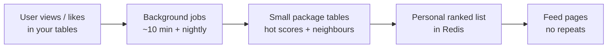
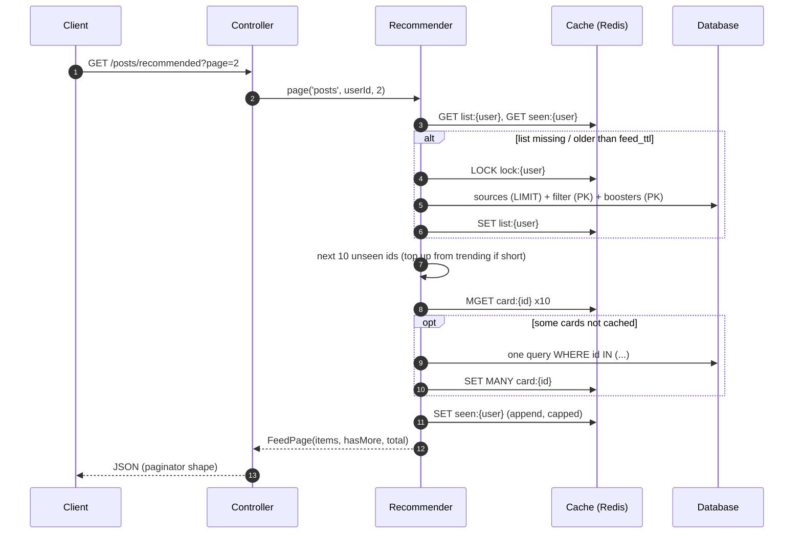
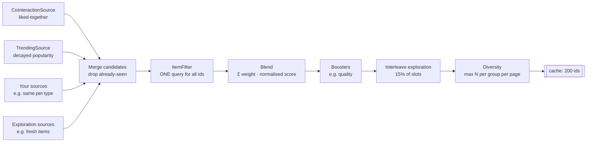

# Laravel Recommender

[](LICENSE)
[](https://github.com/solutionforest/laravel-recommender/actions/workflows/tests.yml)

`solutionforest/laravel-recommender` is a self-hosted recommendation engine for Laravel. It doesn't depend on any outside service.

It builds a ranked **"for you" list per user** from data your app already stores, such as likes, views and follows. Each user's list is cached, and the API serves pages by slicing that list. Each request costs a few cache reads and at most one primary-key query, with no external API call, no `ORDER BY RAND()` and no `COUNT(*)`.

**Highlights:**
- Works with Laravel 10, 11, 12 and 13 on PHP 8.1+.
- Needs a **cache** (Redis recommended in production) and a queue.
- **Math you can explain:** item–item CF (Amazon-style), Wilson quality (Reddit-style), exponential half-life trending with **incremental log-sum-exp** updates — see [Ideas & maths](#ideas--maths).
- **Never copies your raw events.** It reads your existing tables. Its own 3 tables grow with the number of *recently active items*, never with traffic.
- **Every write is bulk:** chunked upserts, inserts and deletes. Every read is either indexed and `LIMIT`ed, or a primary-key lookup.
- **Runnable sample:** [`examples/blog`](examples/blog) shows the whole integration in about 200 lines. It is covered by the test suite.

> Built for an *inspiration reviews* feed. Nothing in it is specific to reviews; a feed can hold anything with an id.

---

## Contents

1. [How it works](#how-it-works)
2. [Ideas & maths](#ideas--maths)
3. [Quick start (5 steps)](#quick-start-5-steps)
4. [First-time go-live checklist](#first-time-go-live-checklist)
5. [Fine-tuning weights](#fine-tuning-weights)
6. [Lessons from a real inspiration feed](#lessons-from-a-real-inspiration-feed)
7. [Installation](#installation)
8. [Contracts reference](#contracts-reference)
9. [Serving a feed](#serving-a-feed)
10. [Background jobs](#background-jobs)
11. [Configuration reference](#configuration-reference)
12. [Performance, scale and storage](#performance-scale-and-storage)
13. [Operations](#operations)
14. [Testing](#testing)
15. [FAQ](#faq)
16. [Limitations and roadmap](#limitations-and-roadmap)

> **Ops TL;DR:** three small package tables + Redis lists. Jobs run every **10 min / nightly / daily**. Writes are short bulk transactions with `withoutOverlapping()` — designed so you do **not** deadlock the app DB or blow PHP memory. Details: [Performance, scale and storage](#performance-scale-and-storage).

---

## How it works

### The big picture

Imagine a user scrolling your app.

1. **They open a few posts** (views) and **heart a couple** (likes). Those rows already live in *your* tables — this package does not copy them.
2. **Every ~10 minutes** a job glances at *new* likes/views and updates a small “how hot is this item?” score. Last night’s viral post still counts; last year’s does not.
3. **Once a night** another job asks: “people who liked *this* also liked *what*?” and stores a short neighbour list per item (same idea as Amazon “customers also bought”).
4. **When they open the “for you” feed**, the package builds a personal ranked list from those signals (plus trending / your own rules), remembers what they already saw, and serves the next page from cache. Scroll → next batch, no repeats.
5. **Guests / brand-new users** get a shared trending list until they have enough history of their own.

In one line: **what they looked at and liked → quiet background learning → a personal “next cards” list ready in Redis.**



Three speeds (you do **not** recompute the whole world on every scroll):

| When | What happens | Feels like |
|---|---|---|
| **Every scroll** | Slice the cached list; mark those cards as seen | Instant |
| **~every 30 min per active user** | Rebuild that user’s ranked list if it’s stale | Fresh “for you” |
| **~10 min / nightly / daily** | Score new events, rebuild neighbours, prune idle rows | Learning catches up in the background |

### A request, step by step



### How a feed is built



1. **Candidates.** Each source returns up to `source_limit` ids with a score, from one or two indexed queries with a `LIMIT`. A source that throws is logged and skipped.
2. **Filter.** Your `ItemFilter` gets *all* candidate ids at once and returns the ones that may be shown: published, not hidden, not the user's own, not from blocked authors.
3. **Blend.** `score = Σ weight_source · score_source / max(score_source)`. Every source is normalised to 0..1, so weights are comparable.
4. **Boost.** Boosters add to existing candidates only. `QualityBooster` uses the Wilson lower bound of likes/views, so an item with 1 view and 1 like doesn't beat one with 80 likes out of 100 views.
5. **Explore.** About 15% of slots go to exploration items (fresh or trending), so new content gets exposure before it has any likes.
6. **Diversify.** For example, at most 1 post per author per page. Items over the cap move to the next page; nothing is dropped.

### The two algorithms inside

Short version below; full story in [Ideas & maths](#ideas--maths).

**Item-to-item similarity** (cosine over co-interactors) + **time-decayed `hot`** stored in log space and updated with log-sum-exp — so trending stays correct without re-scanning history every request.

---

## Ideas & maths

This package is not a black-box neural ranker. It assembles **classic, production-proven ideas** so product / eng can *explain* every card (`recommender:explain`) and tune weights without retraining a model.

| Idea in the package | Where it shows up | Classical lineage |
|---|---|---|
| Item–item collaborative filtering | `build-neighbours`, `CoInteractionSource` | Same family as **Amazon’s item-to-item CF** (Linden et al.): “people who engaged with *X* also engaged with *Y*” — stable for sparse likes/views, no per-request matrix multiply |
| Cosine on binary interaction sets | Neighbour similarity | Standard IR / CF measure: popular items don’t automatically dominate just by volume |
| Exponential half-life decay | `half_life_days`, `hot` score | Same *shape* as **HN / Reddit-style time decay** and radioisotope half-life: yesterday’s hit still counts, last year’s doesn’t |
| Incremental log-sum-exp | `Math::logAddExp` / `hotTerm` | Numerical trick so we store **one number per item** and fold new events in *O(1)* without overflowing `e^{λt}` |
| Wilson score interval (lower bound) | `QualityBooster` | **Reddit’s** ranking insight (Evan Miller / Wilson): rank by the *conservative* estimate of like-rate so 1/1 doesn’t beat 80/100 |
| Linear blend of normalised sources | `Blender` | Multi-objective ranking: each signal 0..1, then `Σ w·s` — transparent A/B and product knobs |
| Exploration interleave | `Explorer` + `exploration_ratio` | Lightweight **explore/exploit**: reserve slots for fresh items so the catalog doesn’t freeze on old winners |
| Per-page diversity caps | `Diversifier` + `groups` | Presentation constraint (max N per shop/author) without dropping candidates — fairer pages, same pool |

### 1. Item–item CF (“liked / viewed together”)

Nightly job builds, for each item *a*, the top neighbours *b*:

$$
\mathrm{sim}(a,b)=\frac{|U_a \cap U_b|}{\sqrt{|U_a|\,|U_b|}}
$$

where $U_x$ is the set of users who interacted with item *x* (within `history_days`, capped per user). Optional floor: `neighbours_min_co_count` ignores flimsy pairs.

At request time, `CoInteractionSource` does **not** recompute that. It loads the user’s recent items (`recent_items`), one PK read of their neighbour JSON, and scores candidates:

$$
\mathrm{score}(c)=\sum_{i \in \mathrm{recent}} \mathrm{sim}(i,c)\cdot \frac{1}{1+0.1\cdot \mathrm{rank}(i)}
$$

More recent seeds weigh more. That is Amazon-style **item–item** (not user–user), which stays cheap when you have many users and fewer active items.

### 2. Trending `hot` without replaying history

Decayed popularity at wall-clock time $T$:

$$
\mathrm{pop}(T)=\sum_k w_k\, e^{-\lambda (T-t_k)},\quad \lambda=\frac{\ln 2}{H}
$$

where $H$ is `half_life_days`. Ranking by $\mathrm{pop}(T)$ is identical to ranking by

$$
\mathrm{hot}=\log\sum_k w_k\, e^{\lambda t_k}
$$

because $e^{-\lambda T}$ is common to every item at query time. So we **store `hot` once** and, for each new event, update:

$$
\mathrm{hot} \leftarrow \mathrm{logAddExp}(\mathrm{hot},\ \log w + \lambda\cdot \mathrm{days}(t))
$$

(`Math::hotTerm` + `Math::logAddExp`). Every ~10 minutes `update-scores` reads only events since the watermark; `ORDER BY hot DESC LIMIT n` stays correct as time passes. No nightly full re-aggregation for trending.

### 3. Wilson quality (likes vs views)

Raw like-rate $p = \mathrm{pos}/n$ over-rewards tiny samples. We use the **95% Wilson lower bound** (same formula Reddit popularised):

$$
\frac{p+\frac{z^2}{2n}-z\sqrt{\frac{p(1-p)+\frac{z^2}{4n}}{n}}}{1+\frac{z^2}{n}}
\quad(z\approx 1.96)
$$

Then scale so the best candidate in the batch is `1.0`. One lucky like on one view cannot dominate a well-tested item.

### 4. Blend, explore, diversify (product maths)

- **Blend:** each source’s scores ÷ that source’s max → then `Σ weight · score`. Weights are comparable across unlike signals (co-view vs pet-match vs trending).
- **Explore:** ~`exploration_ratio` of slots are interleaved from `exploration_sources` (fresh / trending) so new content gets a chance before it has history.
- **Diversify:** greedy cap per group per page (e.g. max 2 per shop). Overflow slides to later pages; nothing is deleted from the pool.

### What we are *not* claiming

We are **not** shipping deep learning, two-tower retrieval, or online Bayesian bandits. For sparse first-party like/view data, this **interpretable baseline** is often the right production default: fast, explainable, tunable, and strong enough that many products ship it for years. You can still plug a learned `CandidateSource` later and give it a weight.

Unit coverage: `tests/Unit/ScoringTest.php` (Wilson, decay, log-sum-exp, blend, exploration, diversity).

---

## Quick start (5 steps)

This is the complete version of what [`examples/blog`](examples/blog) does. That folder is runnable and is covered by `tests/Feature/BlogExampleTest.php`.

**1. Tell the package where your interactions are** (`InteractionSource`):

```php
class PostInteractionSource implements InteractionSource
{
    public function between(DateTimeInterface $from, DateTimeInterface $to): iterable
    {
        foreach (DB::table('post_likes')->where('created_at', '>', $from)->where('created_at', '<=', $to)
            ->select(['id', 'user_id', 'post_id', 'created_at'])->lazyById(1000) as $row) {
            yield new Interaction($row->user_id, $row->post_id, 'like', Carbon::parse($row->created_at));
        }
        // ... same for post_views with 'view'
    }

    public function userHistories(DateTimeInterface $since, int $perUser): iterable { /* stream users in id ranges */ }

    public function recentItems(int|string $userId, int $limit): array { /* latest post ids of this user */ }
}
```

**2. Add your business rules** (`ItemFilter`), as one query:

```php
public function allowed(Context $context, array $ids): array
{
    return Post::whereIn('id', $ids)->where('published', true)
        ->when($context->userId, fn ($q) => $q->where('author_id', '<>', $context->userId))
        ->pluck('id')->all();
}
```

**3. Decide what the API returns** (`CardTransformer`):

```php
public function cards(array $ids): array
{
    return Post::whereIn('id', $ids)->where('published', true)->get()
        ->mapWithKeys(fn ($p) => [$p->id => ['id' => $p->id, 'title' => $p->title]])->all();
}
```

**4. Wire the feed** in `config/recommender.php`:

```php
'feeds' => [
    'posts' => [
        'sources' => [CoInteractionSource::class => 0.6, TrendingSource::class => 0.2],
        'boosters' => [QualityBooster::class => 0.2],
        'exploration_sources' => [FreshPostSource::class],
        'diversity' => ['author' => 1],
        'events' => ['view' => 1.0, 'like' => 4.0],
        'interactions' => PostInteractionSource::class,
        'filter' => VisiblePostFilter::class,
        'cards' => PostCardTransformer::class,
        'groups' => PostAuthorGroups::class,
    ],
],
```

**5. Serve it and schedule the jobs:**

```php
// routes/api.php
Route::get('/posts/recommended', RecommendedPostsController::class);

// RecommendedPostsController
$result = Recommender::page('posts', $request->user()?->id, (int) $request->query('page', 1));

return new LengthAwarePaginator($result->items, $result->total(), $result->perPage, $page);
```

```php
// app/Console/Kernel.php
$schedule->command('recommender:update-scores')->everyTenMinutes()->withoutOverlapping()->onOneServer();
$schedule->command('recommender:build-neighbours')->dailyAt('03:30')->withoutOverlapping(120)->onOneServer();
$schedule->command('recommender:prune')->dailyAt('04:30')->withoutOverlapping(60)->onOneServer();
```

Before you go live, run the two jobs once to fill the tables:

```bash
php artisan recommender:update-scores
php artisan recommender:build-neighbours
```

Then check a ranking:

```bash
php artisan recommender:explain posts 1
```

---

## First-time go-live checklist

Do this **once** after wiring contracts and config. Skipping it is the usual reason a feed looks “empty”, “only trending”, or “not personal”.

| Step | Command / action | Why |
|---|---|---|
| 1 | `php artisan migrate` | Creates `rec_item_scores`, `rec_item_neighbours`, `rec_state` |
| 2 | Publish config (optional) | `php artisan vendor:publish --tag=recommender-config` |
| 3 | Index **your** interaction / item tables | Sources are your SQL — without `(user_id, created_at)`, `(item_id, created_at)`, etc. builds are slow |
| 4 | Backfill scores | `php artisan recommender:update-scores {feed}` |
| 5 | Build neighbours | `php artisan recommender:build-neighbours {feed}` |
| 6 | Explain a known active user | `php artisan recommender:explain {feed} {userId}` — expect `CoInteractionSource` / custom sources, not only `TrendingSource` |
| 7 | Schedule the three jobs | See [Background jobs](#background-jobs) |
| 8 | Redis (prod) + dedicated queue worker | Cache locks + `queue:work --queue=recommender`. Lab may use `array`/`database` (unlocked fallback). |

### Historical imports (lab / migration from an old feed)

Default `scores_backfill_days` is **30**. If you import years of clicks/likes, either:

1. Truncate `rec_item_scores` for that feed and delete `rec_state` key `scores:{feed}:watermark`, **or**
2. Set a temporary large window on the feed, e.g. `scores_backfill_days => 1600`, `scores_slice_minutes => 10080` (weekly slices), run `update-scores`, then restore smaller incremental settings.

Then rebuild neighbours with enough history (`history_days`) so `CoInteractionSource` is not empty.

### Livewire / HTTP `Artisan::call`

Package console commands are registered even when the app is not in the CLI so Ops panels and Livewire can call them. Prefer queued jobs in production; Artisan::call is fine for a local lab.

### Cache after config or weight changes

Changing `sources` / `boosters` does not rebuild cached lists by itself:

```php
Recommender::forgetUser('reviews', $userId);
Recommender::forgetTrending('reviews');
// or flush keys under your RECOMMENDER_PREFIX
```

---

## Fine-tuning weights

Weights are **relative**. The blender mixes each source’s scores, then boosters. Exploration **interleaves** a share of slots from `exploration_sources` (not the same as raising a source weight).

### Recipes (starting points)

**A. Inspiration / “for you” (personal first)** — use when signals like co-view, related shops, pet match matter:

```php
'sources' => [
    CoInteractionSource::class => 0.35,
    RelatedShopSource::class => 0.20,   // your CandidateSource
    PetMatchSource::class => 0.25,      // your CandidateSource
    TrendingSource::class => 0.15,
    FreshReviewSource::class => 0.05,   // your CandidateSource
],
'boosters' => [
    QualityBooster::class => 0.20,
    FreshnessBooster::class => 0.05,    // your Booster — keep small
],
'exploration_ratio' => 0.10,
```

**B. Fresher home feed (chronological spice)** — use when “new posts first” matters more than peers:

```php
'sources' => [
    FreshReviewSource::class => 0.45,
    CoInteractionSource::class => 0.25,
    TrendingSource::class => 0.20,
],
'boosters' => [
    FreshnessBooster::class => 0.35,
    QualityBooster::class => 0.10,
],
'exploration_ratio' => 0.25,
'half_life_days' => 3,
```

Raising freshness a lot makes **every cohort look the same** (dog vs cat owners see the same newest posts). Prefer recipe A for pet / segment personalisation demos.

**C. Cold start / guests** — already built in: guests and empty personal lists fall back to `trending_sources`. Keep at least one source that works with `$context->userId === null` (usually `TrendingSource` + a fresh source).

### How to tune in practice

1. Pick 2–3 **real** users with different signals (e.g. dog-only, cat-only, heavy clicker, brand-new user).
2. Run `php artisan recommender:explain {feed} {userId} --limit=12`.
3. Read which sources appear on the top rows. If you only see `Fresh*` / `Trending*`, personal sources are too weak **or** empty (no neighbours, no journey shops, …).
4. Change **one** weight at a time; forget user + trending cache; re-explain.
5. Watch latency: `source_limit` / `feed_size` / heavy `CandidateSource` SQL dominate cold builds (SQLite lab: keep `source_limit` ~100–200).

### Knobs that are not weights

| Knob | Effect |
|---|---|
| `exploration_ratio` | Fraction of slots reserved for exploration pool (fresh exposure) |
| `half_life_days` | How fast trending “hot” forgets old events |
| `history_days` / `neighbours_min_co_count` | Density of the neighbour graph → strength of `CoInteractionSource` |
| `recent_items` | How many of the user’s recent items seed co-interaction |
| `feed_size` / `trending_size` / `seen_max` | How long a unique scroll lasts before recycle / end |
| `diversity` | Cap per shop/author/… per page (needs `groups`) |

---

## Lessons from a real inspiration feed

Validated against a production-shaped reviews feed (SQLite lab: ~50k reviews, clicks, likes, pets, journeys).

| Observation | Takeaway |
|---|---|
| **“Latest first” fights personalisation** | High `Fresh*` + `FreshnessBooster` made cat and dog owners see the same newest cards. Keep freshness as a **spice**. |
| **Peer signals ≠ content topic** | “Same `pet_type_id` as writer” ≠ “card is about cats”. Multi-pet writers match several cohorts. Segment demos need strong peer weight **and** realistic expectations. |
| **Empty `CoInteractionSource`** | Neighbour graph was tiny until `build-neighbours` ran over enough history; users’ clicked items had 0 neighbours. Always explain after rebuild. |
| **Huge journey payloads** | Loading a multi-thousand-id `related_bu` JSON just to `array_slice(0, 20)` is slow. Prefer `recent_view_*` first; only open related lists when needed. |
| **Source SQL shape** | Prefer one indexed `whereIn` + PHP cap-per-group, or bounded `UNION ALL` of per-id `LIMIT`s — not unbounded `ORDER BY created_at` over large IN lists. |
| **First paint for new users** | Works via trending + exploration; page 1 is never empty if trending has scores. |
| **Scroll is long, not infinite** | Unique depth ≈ `feed_size` + `trending_size`, then recycle via `seen_max`. App-level **catalog tail** after `hasMore` is false: see [`examples/blog/src/InfiniteScrollFeed.php`](examples/blog/src/InfiniteScrollFeed.php). |
| **Media URLs** | If `cover_url` can be `.mp4`, map to a poster/thumb in `CardTransformer` — do not put video URLs in ``. |
| **Ops from HTTP** | Commands must be callable outside CLI (already supported) for Livewire labs; debounce live user-id inputs so every keystroke does not rebuild. |
| **Freshness vs segments** | High Fresh\* weights erase pet/cohort differences — keep as spice; omit or tiny weight. |
| **Sponsored shops** | `SponsoredShopSource` + `SponsoredShopBooster` + diversity caps — see [`examples/blog`](examples/blog). |

### Better first-time / config support (wishlist)

Useful package upgrades suggested by that experience (not all shipped yet):

1. **`php artisan recommender:bootstrap {feed}`** — migrate check, one-shot scores + neighbours, print explain for a sample user, warn if `CoInteraction` is empty.
2. **Named presets** in config (`inspiration`, `fresh_home`) that expand to weight sets.
3. **Backfill helpers** — e.g. `update-scores --from=2022-01-01` / `--slice=1d` without hand-editing watermark keys.
4. **Explain shows weighted contributions** (not only raw per-source scores) and flags empty sources.
5. **Optional built-in `FreshnessBooster`** (age from an item table callback) so apps do not reimplement decay.
6. **Health metrics** — neighbour coverage %, score watermark lag, cold-build p95.

---

## Installation

Until the package is on Packagist, add it as a VCS repository:

```json
// composer.json of your app
"repositories": [
    { "type": "vcs", "url": "https://github.com/solutionforest/laravel-recommender" }
],
"require": {
    "solutionforest/laravel-recommender": "^0.1"
}
```

Then install and migrate:

```bash
composer update solutionforest/laravel-recommender
php artisan migrate     # rec_item_scores, rec_item_neighbours, rec_state
php artisan vendor:publish --tag=recommender-config      # optional
```

The service provider and the `Recommender` facade are auto-discovered.

### Cache requirement (Redis vs lab drivers)

| Environment | Recommended | Why |
|---|---|---|
| **Production** | **Redis** (`CACHE_STORE=redis`, or `RECOMMENDER_CACHE_STORE=redis`) | Atomic **per-user build locks**, fast list/seen/card reads. Two tabs for the same user will not stampede rebuilds. |
| **Local / CI lab** | `array`, `file`, or `database` | Works out of the box. If the store cannot provide locks, the package **falls back** to building without a lock (last write wins). Fine for one developer; not ideal under concurrent load. |

```bash
# Production (or Herd with Redis)
CACHE_STORE=redis
# or only for this package:
RECOMMENDER_CACHE_STORE=redis
```

If you keep `CACHE_STORE=database`, create Laravel’s cache + lock tables (`php artisan cache:table` / `cache:table --locks` and migrate) **or** accept the unlocked fallback. Redis remains the production recommendation.

---

## Contracts reference

All classes are resolved from the container, so constructor injection works.

| Contract | Required | Called by | Must be |
|---|---|---|---|
| `InteractionSource` | for jobs | `update-scores` (`between`), `build-neighbours` (`userHistories`), `CoInteractionSource` (`recentItems`) | streaming, bulk reads |
| `ItemFilter` | recommended | every build and every trending build | **one** query for all ids |
| `CardTransformer` | yes | card cache misses | one query, no viewer-specific fields |
| `CandidateSource` | your own signals | every build | one or two indexed queries with `LIMIT` |
| `Booster` | optional | every build, on candidate ids only | one query |
| `DiversityGroups` | optional | every build | one query |

A few rules that matter:
- **`$context->userId` is `null`** when the shared trending list is built. Filters and sources must handle guests.
- **Cards are cached per item and shared by every user.** Merge "liked by me" and similar fields in the controller. Apply the same visibility rules in the transformer as in the filter: an item hidden after the build is then skipped and the page is topped up.
- **Context attributes:** anything you pass as `attributes` to `page()` is available as `$context->attribute('user')`, which saves loading the user again. Queued builds (`warm()`) have no attributes, so fall back to `$context->userId`.

Built-in classes:

| Class | Type | What it does |
|---|---|---|
| `Sources\CoInteractionSource` | source | Neighbours of the user's recent items |
| `Sources\TrendingSource` | source | `ORDER BY hot DESC LIMIT n` |
| `Boosters\QualityBooster` | booster | Wilson lower bound of positive / exposure events |

---

## Serving a feed

```php
use SolutionForest\Recommender\Facades\Recommender;

$result = Recommender::page('posts', $user?->id, page: $page, perPage: 10, attributes: ['user' => $user]);

$result->items;     // cards, in order
$result->ids;       // their ids
$result->hasMore;   // more items queued
$result->total();   // for LengthAwarePaginator
$result->origin;    // 'personal' or 'trending'
```

These are the rules `page()` follows:
- **Page 1 reuses the list** while it's fresh (`feed_ttl`). It rebuilds when the list is stale or nearly fully seen.
- **Later pages skip everything already served** (the seen-set).
- **When the personal list runs out**, it continues with the shared trending list. Page 1 is never empty.
- **Guests (`null` user)** get the trending list, paginated by offset.

Other entry points:

```php
Recommender::warm('posts', $userId);       // queue a background build (e.g. on login / app open)
Recommender::forgetCard('posts', $id);     // call from model events after edit / hide / delete
Recommender::forgetUser('posts', $userId); // reset a user's list and seen-set
Recommender::trending('posts');            // shared list (ids)
Recommender::explain('posts', $userId);    // per-source score breakdown
```

---

## Background jobs

### How often to run them

| Cadence | Command | Why this frequency |
|---|---|---|
| **Every ~10 minutes** | `recommender:update-scores` | Folds *new* likes/views into `hot` / quality counts. Only events since the last watermark are read — cost tracks traffic in that window, not total history. |
| **Nightly (e.g. 03:30)** | `recommender:build-neighbours` | Rebuilds the item–item graph used by `CoInteractionSource`. Cheap enough daily; you do **not** need it on every request. |
| **Daily (e.g. 04:30)** | `recommender:prune` | Deletes idle `rec_item_scores` rows older than `scores_retention_days` so the scores table stays bounded. |

Always schedule with `withoutOverlapping()` (and `onOneServer()` if you have multiple schedulers) so a slow run cannot start a second copy:

```php
// app/Console/Kernel.php  (or routes/console.php schedule)
$schedule->command('recommender:update-scores')->everyTenMinutes()->withoutOverlapping()->onOneServer();
$schedule->command('recommender:build-neighbours')->dailyAt('03:30')->withoutOverlapping(120)->onOneServer();
$schedule->command('recommender:prune')->dailyAt('04:30')->withoutOverlapping(60)->onOneServer();
```



```mermaid
gantt
  dateFormat  HH:mm
  axisFormat  %H:%M
  title Daily schedule (example)
  section every 10 min
  update-scores (new events only) :active, 00:00, 24h
  section nightly
  build-neighbours (90 days, capped) :03:30, 40m
  section daily
  prune (idle score rows) :04:30, 10m
```

| Command | What it reads | What it writes | Why it stays cheap |
|---|---|---|---|
| `recommender:update-scores` | events since the watermark | `rec_item_scores` | Works in **time slices** (`scores_slice_minutes`). Each slice's bulk upserts and its watermark commit in **one transaction**. Memory is bounded by the items touched in one slice. After a crash it resumes after the last committed slice, and **no event is ever counted twice**. |
| `recommender:build-neighbours` | `history_days` of history, at most `history_per_user` items per user | `rec_item_neighbours` | Pairs are counted in **shards**: only 1/S of the items are in memory at once. Over `neighbours_memory_limit_mb`, the build restarts with 2×S shards, and the shard count that worked is remembered. Rows are bulk inserted under a new version that is **activated atomically**. Old versions are deleted in chunks. |
| `recommender:prune` | `rec_item_scores` | deletes | Removes rows with no event for `scores_retention_days`, in primary-key chunks (`delete_chunk`). |
| `recommender:explain {feed} {user?}` | – | – | Debugging |

The warm-up job `Jobs\BuildFeed` runs on the `recommender` queue and is `ShouldBeUnique` per feed and user. Give it its own worker so recommendation work never delays other jobs:

```bash
php artisan queue:work --queue=recommender
```

**You do not need to rebuild on every request.** Live traffic only reads Redis (lists / seen / cards) plus at most one primary-key card fetch. Jobs keep the three package tables fresh in the background.
---

## Configuration reference

Top level:

| Key | Env | Default | Purpose |
|---|---|---|---|
| `enabled` | `RECOMMENDER_ENABLED` | `true` | **Kill switch.** `false` serves the shared trending list only. |
| `cache_store` | `RECOMMENDER_CACHE_STORE` | default | Store for lists, seen-sets, cards and locks |
| `prefix` | `RECOMMENDER_PREFIX` | `rec` | Prefix of every cache key |
| `queue` / `queue_connection` | `RECOMMENDER_QUEUE` / `…_CONNECTION` | `recommender` / default | Where `BuildFeed` runs |
| `database_connection` | `RECOMMENDER_DB_CONNECTION` | default | Connection for the package tables |

Per feed (`defaults`, overridable in `feeds.*`):

| Key | Default | Purpose |
|---|---|---|
| `page_size` | 12 | Page size, also used by the diversity pass |
| `feed_size` | 200 | Ids kept per user |
| `feed_ttl` | 1800 | Seconds before a list is rebuilt |
| `min_rebuild_interval` | 60 | Page 1 rebuilds an exhausted list at most this often |
| `source_limit` | 200 | Candidates requested from each source |
| `seen_ttl` / `seen_max` | 3 days / 200 | Seen-set lifetime and size, stored packed |
| `trending_sources` | `[TrendingSource => 1]` | Sources that work without a user |
| `trending_size` / `trending_ttl` | 200 / 600 | Shared list size and lifetime |
| `card_ttl` | 3600 | Card cache lifetime |
| `build_lock_seconds` / `build_lock_wait` | 10 / 2 | Build lock duration and wait |
| `sources` / `boosters` | – | `class => weight` |
| `exploration_sources` / `exploration_ratio` | – / 0.15 | Exploration pool and its share of slots |
| `diversity` | – | `group => max per page` |
| `events` | view 1, like 4 | Event weights for trending |
| `positive_events` / `exposure_events` | like / view | Inputs of the quality score |
| `half_life_days` | 7 | Trending decay |
| `scores_backfill_days` | 30 | First run of `update-scores` |
| `scores_slice_minutes` | 60 | Commit size of `update-scores` |
| `scores_retention_days` | 180 | `prune` threshold |
| `history_days` / `history_per_user` | 90 / 30 | Neighbour job input bounds |
| `recent_items` | 20 | User items used by `CoInteractionSource` |
| `neighbours_max` / `neighbours_min_co_count` | 30 / 2 | Neighbour output bounds |
| `neighbours_memory_limit_mb` / `neighbours_max_shards` | 512 / 64 | Memory guard for the neighbour job. Capped at 80% of PHP's `memory_limit`. |
| `write_chunk` / `delete_chunk` | 500 / 5000 | Rows per bulk insert/upsert and per chunked delete |
| `interactions`, `filter`, `cards`, `groups` | – | Your classes |

---

## Performance, scale and storage

### What is stored where

The package **never copies your likes/views tables**. It keeps three small derived tables (plus Redis for hot-path lists):

| Store | Holds | Grows with | Cleared / bounded by |
|---|---|---|---|
| **`rec_item_scores`** | per-item `hot`, like/view counters, `last_event_at` | *recently active* items (not total traffic) | `recommender:prune` + `scores_retention_days` |
| **`rec_item_neighbours`** | top-N similar item ids (JSON) per item | items that have neighbours | nightly rebuild writes a **new version**, then deletes the old one in chunks |
| **`rec_state`** | watermarks (`scores:{feed}:watermark`), active neighbour version, shard count | a handful of keys | overwritten in place |
| **Redis (or lock-capable cache)** | per-user ranked id list, seen-set, card payloads, build locks, shared trending list | *active* users | TTLs (`feed_ttl`, `seen_ttl`, `card_ttl`, `trending_ttl`) |

Your app tables stay the source of truth. Jobs *read* them through your `InteractionSource`; they only *write* the three `rec_*` tables and cache keys under `RECOMMENDER_PREFIX`.

Rough footprint: ~100 B per score row, ~400 B per neighbour row → **100k active items ≈ tens of MB**, not GB. Redis ≈ 1.5 KB list + 1.5 KB seen-set per active user.

### Deadlocks, locks, and overlapping runs

Designed so ops teams do not need to fear lock storms:

| Concern | How the package handles it |
|---|---|
| **Two score jobs at once** | Schedule with `withoutOverlapping()`. Each slice is one short DB transaction (bulk upsert + watermark). No long open transaction across the whole backfill. |
| **Score job vs live traffic** | Requests do **not** touch `rec_item_scores` / `rec_item_neighbours` on the hot path — they read Redis. Live users are not blocked by job upserts. |
| **Neighbour rebuild mid-request** | New rows are written under a **new version**. Readers keep using the previous active version until activate flips the pointer; then old rows are deleted in `delete_chunk` batches (no giant multi-minute `DELETE`). |
| **Two builds for the same user** | Per-user **cache lock** when the store supports it (`build_lock_seconds` / `build_lock_wait`). Busy lock → serve existing list. **Without locks** (some `database`/`file` labs): builds still run; concurrent rebuilds may race (last write wins). Use Redis in production. |
| **Warm-up job pile-up** | `BuildFeed` is `ShouldBeUnique` per feed+user on the `recommender` queue. |
| **App-table deadlocks** | Jobs only **SELECT** your interaction tables (via your source). They do not update likes/views. Deadlock risk on *your* write-heavy tables is unchanged by this package. |
| **Long row locks** | Writes are chunked (`write_chunk` / `delete_chunk`). Prefer InnoDB; avoid running `build-neighbours` and a huge manual `DELETE` on the same table at once. |

If a job crashes mid-slice, the watermark (scores) or version activation (neighbours) means the next run **resumes cleanly** — scores are not double-counted; a failed neighbour version is discarded and the previous graph stays live.

### Memory bounds

| Path | Memory behaviour |
|---|---|
| **HTTP `page()`** | O(page): a few cache reads + one card query. Does not load the neighbour graph or score table into PHP. |
| **`update-scores`** | Aggregates **one time slice** at a time (`scores_slice_minutes`). Peak ≈ items touched in that slice, not “all events ever”. |
| **`build-neighbours`** | Counts pairs in **shards** (1, then 2, 4, …). Only one shard’s co-occurrence map is in memory. If usage exceeds `neighbours_memory_limit_mb` (capped at 80% of PHP `memory_limit`), that attempt is **thrown away** and the job retries with more shards. The last good neighbour version stays served. |
| **Prune** | Deletes by primary-key id lists of size `delete_chunk` — no loading the whole scores table. |

Knobs when a host is tight: lower `history_per_user` / `history_days`, raise `neighbours_max_shards`, lower `neighbours_memory_limit_mb`, or shorten `scores_slice_minutes` so each score transaction is smaller.

### What happens at 100× data

| Part | Grows with | At 100× |
|---|---|---|
| Request | nothing | Same: 3–4 cache calls plus at most 1 primary-key query |
| Feed build | active users (not rows) | More builds, each the same size. 10k concurrent users ≈ 5–6 builds/s ≈ 30–40 small queries/s. |
| `update-scores` | events per 10 min | Bigger slices, same memory per slice |
| `build-neighbours` | active users × capped history | More shards, so memory stays under the budget. Runtime grows roughly linearly. |
| `rec_item_scores` | *recently active* items | Bounded by `prune` |
| `rec_item_neighbours` | items with neighbours | 1 row per item, old versions deleted |
| Redis | active users | about 1.5 KB list + about 1.5 KB seen-set per active user |

### Writes are always bulk

| Write | How |
|---|---|
| Scores | `upsert()` of up to `write_chunk` rows: 1,200 items → 3 statements |
| Neighbours | `insert()` of up to `write_chunk` rows per statement |
| Old versions, pruning | `DELETE … WHERE id IN (…)` in `delete_chunk` batches, so statements stay short and never hold a long lock |
| Cards | one `putMany` (Redis `MSET`) per page of misses |
| Seen-set / list | one `SET` per page / build, packed as `id,id,…` (about 7 bytes per id instead of about 15 serialized) |

These are asserted in `tests/Feature/ScaleTest.php` by counting the SQL statements.

### Your queries matter too

Sources run your SQL, so make sure they read the newest N rows through an index instead of sorting everything. Measured on MariaDB 10.11 with **1M rows**, "newest reviews of 30 popular shops (20k reviews each)" took:

| Query | Time |
|---|---|
| `WHERE shop_id IN (30 ids) ORDER BY created_at DESC LIMIT 200` | 470 ms |
| the same, with an index on `(shop_id, created_at)` | 468 ms, still sorts every row |
| one `UNION ALL` of 30 × `(WHERE shop_id = ? ORDER BY created_at DESC LIMIT 14)` on that index | **3.6 ms** |

### Database footprint

| Table | Rows | Typical size |
|---|---|---|
| `rec_item_scores` | 1 per item with an event in `scores_retention_days` | about 100 B/row, so 100k active items ≈ 10 MB |
| `rec_item_neighbours` | 1 per item with neighbours, top 30 packed as JSON | about 400 B/row, so 100k items ≈ 40 MB |
| `rec_state` | a few keys | – |

---

## Operations

| Task | How |
|---|---|
| Stop personalisation immediately | `RECOMMENDER_ENABLED=false`: trending only, no per-user work |
| Flush everything cached | Delete keys `rec:*` (or your prefix) |
| Reset one user | `Recommender::forgetUser('posts', $id)` |
| Debug a ranking | `php artisan recommender:explain posts 123` |
| Rebuild similarities now | `php artisan recommender:build-neighbours posts` |
| Recompute trending from scratch | Truncate `rec_item_scores`, delete `rec_state` key `scores:{feed}:watermark`, run `update-scores` |
| Neighbour job hits the memory guard | It retries with more shards on its own. If it reaches `neighbours_max_shards`, raise the budget or lower `history_per_user`. The previous version stays active. |

Source, booster and build failures are logged as warnings (`[recommender:{feed}] …`), and the request falls back to trending.

---

## Testing

```bash
composer install
composer test                         # or: vendor/bin/pest
composer analyse                      # PHPStan level 8 + Larastan (src + examples/blog)
RECOMMENDER_TEST_DB=mysql DB_HOST=127.0.0.1 DB_DATABASE=rec_test DB_USERNAME=root vendor/bin/pest
```

| Suite | Covers |
|---|---|
| `tests/Unit/ScoringTest.php` | blending, exploration, diversity, Wilson, decay maths |
| `tests/Feature/RecommenderPageTest.php` | paging without repeats, card cache, filters, lock contention, fallbacks, guests, kill switch |
| `tests/Feature/MaintenanceTest.php` | incremental scores, neighbours, history caps, version swap |
| `tests/Feature/ScaleTest.php` | shard equivalence, memory guard, crash-resume without double counting, bulk-write statement counts, chunked prune, packed cache values |
| `tests/Feature/BlogExampleTest.php` | the sample app end to end |

CI (`.github/workflows/tests.yml`) runs **PHPStan**, PHP 8.1–8.4 × Laravel 10–13 on SQLite, and Laravel 13 on MySQL 8.

---

## FAQ

**How is this better than AWS Personalize?**
As a pure ML model it isn't stronger. But for sparse like/view data, item-to-item similarity plus popularity and business rules is a proven baseline. There's no per-request cost or network latency. New likes count within 10 minutes instead of after retraining. Business rules are part of the ranking rather than patched on afterwards, and every card can be explained (`recommender:explain`).

**Will it slow down the database when data grows?**
The request path doesn't touch the database for ranking. Builds are bounded per active user. The jobs read only new or windowed data, write in bulk and are memory-guarded. See [What happens at 100× data](#what-happens-at-100-data).

**Do I need Redis?**
**Production: yes (strongly recommended)** for atomic per-user build locks and fast cache. **Local lab:** `array` / `file` / `database` work; if locks are unavailable the package builds without a lock (tradeoff: concurrent rebuilds for the same user may race). See [Cache requirement](#cache-requirement-redis-vs-lab-drivers).

**Will the jobs deadlock our database?**
Unlikely for the usual fear case. Live requests do not contend on `rec_*` tables; jobs use short chunked transactions and `withoutOverlapping()`; neighbour swaps are versioned so readers keep the previous graph. The package only *reads* your interaction tables. See [Deadlocks, locks, and overlapping runs](#deadlocks-locks-and-overlapping-runs).

**Will `build-neighbours` blow PHP memory?**
It shards pair counting and aborts/retries with more shards under `neighbours_memory_limit_mb`. The previous neighbour version stays live if a pass fails. See [Memory bounds](#memory-bounds).

**How often must we update?**
Scores about every **10 minutes**, neighbours **nightly**, prune **daily**. That is enough for “liked 10 minutes ago shows up in trending/personal.” You do not rebuild on every page view. See [How often to run them](#how-often-to-run-them).

**Can I A/B test it?**
Yes. Decide in the controller which users get `Recommender::page()` and which get the old code, then compare click and like rates.

**Can I add a learned model later?**
Yes. Implement `CandidateSource` and give it a weight.

**Why do cat / dog (or other segment) users see almost the same cards?**
Usually freshness/trending weights dominate, or your peer source matches “same segment as the *writer*” while writers are multi-segment. Raise personal sources, lower `Fresh*` / `exploration_ratio`, and verify with `recommender:explain`. See [Fine-tuning weights](#fine-tuning-weights).

**Why is `CoInteractionSource` missing from explain?**
Neighbours were never built, history window is too short, or `neighbours_min_co_count` filters everything out. Run `recommender:build-neighbours` and check that the user’s recent item ids appear in `rec_item_neighbours`.

**I imported old events; trending still looks empty / tiny.**
First `update-scores` only walks `scores_backfill_days` (default 30). Reset the watermark and widen the backfill, or set the watermark to the start of your data. See [Historical imports](#historical-imports-lab--migration-from-an-old-feed).

**Is the feed infinite?**
No. You get a long personal + trending pool (`feed_size` / `trending_size`). After that, `hasMore` becomes false or the seen-set recycles (`seen_max`). A chronological “catalog tail” after the ranked list is on the wishlist.

---

## Limitations and roadmap

- **Impressions** (shown but not clicked) aren't used yet. They are the next most useful signal.
- **Cursor pagination** isn't exposed. Pages rely on the seen-set; page numbers only drive paginator metadata.
- **No catalog tail** after personal + trending pools are exhausted (long scroll ≠ full catalog).
- **Item-to-item similarity only.** User-to-user or embedding-based sources can be added as `CandidateSource`s.
- **Item ids must not contain commas,** because cached lists are stored packed as `id,id,…`.
- **DX upgrades** listed under [Better first-time / config support](#better-first-time--config-support-wishlist): bootstrap command, presets, backfill flags, richer explain.
