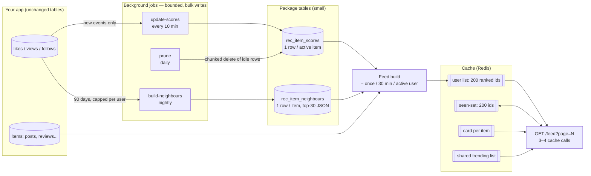
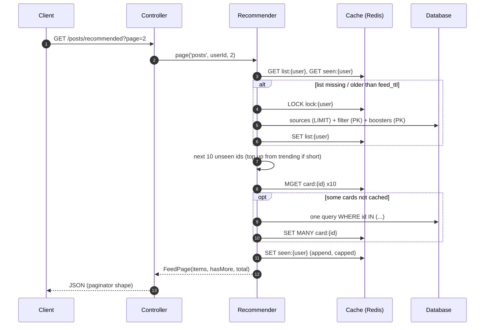
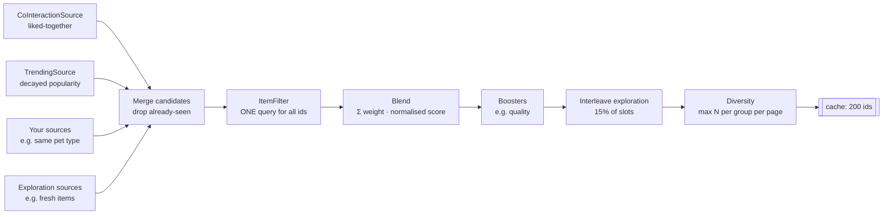

# Laravel Recommender

`solutionforest/laravel-recommender` is a self-hosted recommendation engine for Laravel. It doesn't depend on any outside service.

It builds a ranked **"for you" list per user** from data your app already stores, such as likes, views and follows. Each user's list is cached, and the API serves pages by slicing that list. Each request costs a few cache reads and at most one primary-key query, with no external API call, no `ORDER BY RAND()` and no `COUNT(*)`.

**Highlights:**
- Works with Laravel 10, 11 and 12 on PHP 8.1+.
- Needs a cache store with locks (Redis in production) and a queue.
- **Never copies your raw events.** It reads your existing tables. Its own 3 tables grow with the number of *recently active items*, never with traffic.
- **Every write is bulk:** chunked upserts, inserts and deletes. Every read is either indexed and `LIMIT`ed, or a primary-key lookup.
- **Runnable sample:** [`examples/blog`](examples/blog) shows the whole integration in about 200 lines. It is covered by the test suite.

> Built for pet-a-hood's *inspiration reviews* feed. Nothing in it is specific to reviews; a feed can hold anything with an id.

---

## Contents

1. [How it works](#how-it-works)
2. [Quick start (5 steps)](#quick-start-5-steps)
3. [Installation (private repository)](#installation-private-repository)
4. [Contracts reference](#contracts-reference)
5. [Serving a feed](#serving-a-feed)
6. [Background jobs](#background-jobs)
7. [Configuration reference](#configuration-reference)
8. [Performance, scale and storage](#performance-scale-and-storage)
9. [Operations](#operations)
10. [Testing](#testing)
11. [FAQ](#faq)
12. [Limitations and roadmap](#limitations-and-roadmap)

---

## How it works

### The big picture



There are three layers, and each one runs at a different frequency:

| Layer | Runs | Cost |
|---|---|---|
| **Request** | every scroll | 3–4 cache calls, plus at most 1 primary-key query for uncached cards |
| **Feed build** | about once per 30 min per *active* user, under a per-user lock | about 6 small `LIMIT`ed / primary-key queries |
| **Background jobs** | every 10 min / nightly / daily | read only what's new, or a bounded window; write in bulk chunks |

### A request, step by step



### How a feed is built



1. **Candidates.** Each source returns up to `source_limit` ids with a score, from one or two indexed queries with a `LIMIT`. A source that throws is logged and skipped.
2. **Filter.** Your `ItemFilter` gets *all* candidate ids at once and returns the ones that may be shown: published, not hidden, not the user's own, not from blocked authors.
3. **Blend.** `score = Σ weight_source · score_source / max(score_source)`. Every source is normalised to 0..1, so weights are comparable.
4. **Boost.** Boosters add to existing candidates only. `QualityBooster` uses the Wilson lower bound of likes/views, so an item with 1 view and 1 like doesn't beat one with 80 likes out of 100 views.
5. **Explore.** About 15% of slots go to exploration items (fresh or trending), so new content gets exposure before it has any likes.
6. **Diversify.** For example, at most 1 post per author per page. Items over the cap move to the next page; nothing is dropped.

### The two algorithms inside

**Item-to-item similarity.** The nightly job compares items by the users who interacted with them (cosine similarity):

```
sim(a, b) = |users(a) ∩ users(b)| / sqrt(|users(a)| · |users(b)|)
```

For a user, `CoInteractionSource` takes their 20 most recent items, reads those items' precomputed neighbours (one primary-key query) and adds up the similarities. More recent items get more weight.

**Trending without re-aggregating.** The decayed popularity of an item at time *T* is `Σ w · e^(−λ(T − t))`. Ranking by it is the same as ranking by `log Σ w · e^(λt)`, which does not depend on *T*. So the package stores that value (`hot`) once per item and folds new events into it with a log-sum-exp. Every 10 minutes the job reads only the events since the last run, and `ORDER BY hot DESC LIMIT n` stays correct as time passes.

---

## Quick start (5 steps)

This is the complete version of what [`examples/blog`](examples/blog) does. That folder is runnable and is covered by `tests/Feature/BlogExampleTest.php`.

**1. Tell the package where your interactions are** (`InteractionSource`):

```php
class PostInteractionSource implements InteractionSource
{
    public function between(DateTimeInterface $from, DateTimeInterface $to): iterable
    {
        foreach (DB::table('post_likes')->where('created_at', '>', $from)->where('created_at', '<=', $to)
            ->select(['id', 'user_id', 'post_id', 'created_at'])->lazyById(1000) as $row) {
            yield new Interaction($row->user_id, $row->post_id, 'like', Carbon::parse($row->created_at));
        }
        // ... same for post_views with 'view'
    }

    public function userHistories(DateTimeInterface $since, int $perUser): iterable { /* stream users in id ranges */ }

    public function recentItems(int|string $userId, int $limit): array { /* latest post ids of this user */ }
}
```

**2. Add your business rules** (`ItemFilter`), as one query:

```php
public function allowed(Context $context, array $ids): array
{
    return Post::whereIn('id', $ids)->where('published', true)
        ->when($context->userId, fn ($q) => $q->where('author_id', '<>', $context->userId))
        ->pluck('id')->all();
}
```

**3. Decide what the API returns** (`CardTransformer`):

```php
public function cards(array $ids): array
{
    return Post::whereIn('id', $ids)->where('published', true)->get()
        ->mapWithKeys(fn ($p) => [$p->id => ['id' => $p->id, 'title' => $p->title]])->all();
}
```

**4. Wire the feed** in `config/recommender.php`:

```php
'feeds' => [
    'posts' => [
        'sources' => [CoInteractionSource::class => 0.6, TrendingSource::class => 0.2],
        'boosters' => [QualityBooster::class => 0.2],
        'exploration_sources' => [FreshPostSource::class],
        'diversity' => ['author' => 1],
        'events' => ['view' => 1.0, 'like' => 4.0],
        'interactions' => PostInteractionSource::class,
        'filter' => VisiblePostFilter::class,
        'cards' => PostCardTransformer::class,
        'groups' => PostAuthorGroups::class,
    ],
],
```

**5. Serve it and schedule the jobs:**

```php
// routes/api.php
Route::get('/posts/recommended', RecommendedPostsController::class);

// RecommendedPostsController
$result = Recommender::page('posts', $request->user()?->id, (int) $request->query('page', 1));

return new LengthAwarePaginator($result->items, $result->total(), $result->perPage, $page);
```

```php
// app/Console/Kernel.php
$schedule->command('recommender:update-scores')->everyTenMinutes()->withoutOverlapping()->onOneServer();
$schedule->command('recommender:build-neighbours')->dailyAt('03:30')->withoutOverlapping(120)->onOneServer();
$schedule->command('recommender:prune')->dailyAt('04:30')->withoutOverlapping(60)->onOneServer();
```

Before you go live, run the two jobs once to fill the tables:

```bash
php artisan recommender:update-scores
php artisan recommender:build-neighbours
```

Then check a ranking:

```bash
php artisan recommender:explain posts 1
```

---

## Installation (private repository)

This repository is **private** to the Solution Forest organisation. Add it as a VCS repository:

```json
// composer.json of your app
"repositories": [
    { "type": "vcs", "url": "https://github.com/solutionforest/laravel-recommender" }
],
"require": {
    "solutionforest/laravel-recommender": "^0.1"
}
```

Composer needs read access to the repository.

**Locally:**

```bash
composer config --global github-oauth.github.com <your-token>
```

**CI and Docker builds:** pass a token with read access to this repo, without committing it:

```bash
COMPOSER_AUTH='{"github-oauth":{"github.com":"'"$GITHUB_TOKEN"'"}}' composer install
```

In a Dockerfile, use a build secret (`RUN --mount=type=secret,id=composer_auth ...`) rather than an `ARG`, so the token doesn't end up in an image layer.

Then install and migrate:

```bash
composer update solutionforest/laravel-recommender
php artisan migrate     # rec_item_scores, rec_item_neighbours, rec_state
php artisan vendor:publish --tag=recommender-config      # optional
```

The service provider and the `Recommender` facade are auto-discovered. Use Redis for the cache in production: `CACHE_DRIVER=redis`, or `RECOMMENDER_CACHE_STORE=redis` to use Redis only for the recommender.

---

## Contracts reference

All classes are resolved from the container, so constructor injection works.

| Contract | Required | Called by | Must be |
|---|---|---|---|
| `InteractionSource` | for jobs | `update-scores` (`between`), `build-neighbours` (`userHistories`), `CoInteractionSource` (`recentItems`) | streaming, bulk reads |
| `ItemFilter` | recommended | every build and every trending build | **one** query for all ids |
| `CardTransformer` | yes | card cache misses | one query, no viewer-specific fields |
| `CandidateSource` | your own signals | every build | one or two indexed queries with `LIMIT` |
| `Booster` | optional | every build, on candidate ids only | one query |
| `DiversityGroups` | optional | every build | one query |

A few rules that matter:
- **`$context->userId` is `null`** when the shared trending list is built. Filters and sources must handle guests.
- **Cards are cached per item and shared by every user.** Merge "liked by me" and similar fields in the controller. Apply the same visibility rules in the transformer as in the filter: an item hidden after the build is then skipped and the page is topped up.
- **Context attributes:** anything you pass as `attributes` to `page()` is available as `$context->attribute('user')`, which saves loading the user again. Queued builds (`warm()`) have no attributes, so fall back to `$context->userId`.

Built-in classes:

| Class | Type | What it does |
|---|---|---|
| `Sources\CoInteractionSource` | source | Neighbours of the user's recent items |
| `Sources\TrendingSource` | source | `ORDER BY hot DESC LIMIT n` |
| `Boosters\QualityBooster` | booster | Wilson lower bound of positive / exposure events |

---

## Serving a feed

```php
use SolutionForest\Recommender\Facades\Recommender;

$result = Recommender::page('posts', $user?->id, page: $page, perPage: 10, attributes: ['user' => $user]);

$result->items;     // cards, in order
$result->ids;       // their ids
$result->hasMore;   // more items queued
$result->total();   // for LengthAwarePaginator
$result->origin;    // 'personal' or 'trending'
```

These are the rules `page()` follows:
- **Page 1 reuses the list** while it's fresh (`feed_ttl`). It rebuilds when the list is stale or nearly fully seen.
- **Later pages skip everything already served** (the seen-set).
- **When the personal list runs out**, it continues with the shared trending list. Page 1 is never empty.
- **Guests (`null` user)** get the trending list, paginated by offset.

Other entry points:

```php
Recommender::warm('posts', $userId);       // queue a background build (e.g. on login / app open)
Recommender::forgetCard('posts', $id);     // call from model events after edit / hide / delete
Recommender::forgetUser('posts', $userId); // reset a user's list and seen-set
Recommender::trending('posts');            // shared list (ids)
Recommender::explain('posts', $userId);    // per-source score breakdown
```

---

## Background jobs


| Command | What it reads | What it writes | Why it stays cheap |
|---|---|---|---|
| `recommender:update-scores` | events since the watermark | `rec_item_scores` | Works in **time slices** (`scores_slice_minutes`). Each slice's bulk upserts and its watermark commit in **one transaction**. Memory is bounded by the items touched in one slice. After a crash it resumes after the last committed slice, and **no event is ever counted twice**. |
| `recommender:build-neighbours` | `history_days` of history, at most `history_per_user` items per user | `rec_item_neighbours` | Pairs are counted in **shards**: only 1/S of the items are in memory at once. Over `neighbours_memory_limit_mb`, the build restarts with 2×S shards, and the shard count that worked is remembered. Rows are bulk inserted under a new version that is **activated atomically**. Old versions are deleted in chunks. |
| `recommender:prune` | `rec_item_scores` | deletes | Removes rows with no event for `scores_retention_days`, in primary-key chunks (`delete_chunk`). |
| `recommender:explain {feed} {user?}` | – | – | Debugging |

The warm-up job `Jobs\BuildFeed` runs on the `recommender` queue and is `ShouldBeUnique` per feed and user. Give it its own worker so recommendation work never delays other jobs:

```bash
php artisan queue:work --queue=recommender
```

---

## Configuration reference

Top level:

| Key | Env | Default | Purpose |
|---|---|---|---|
| `enabled` | `RECOMMENDER_ENABLED` | `true` | **Kill switch.** `false` serves the shared trending list only. |
| `cache_store` | `RECOMMENDER_CACHE_STORE` | default | Store for lists, seen-sets, cards and locks |
| `prefix` | `RECOMMENDER_PREFIX` | `rec` | Prefix of every cache key |
| `queue` / `queue_connection` | `RECOMMENDER_QUEUE` / `…_CONNECTION` | `recommender` / default | Where `BuildFeed` runs |
| `database_connection` | `RECOMMENDER_DB_CONNECTION` | default | Connection for the package tables |

Per feed (`defaults`, overridable in `feeds.*`):

| Key | Default | Purpose |
|---|---|---|
| `page_size` | 12 | Page size, also used by the diversity pass |
| `feed_size` | 200 | Ids kept per user |
| `feed_ttl` | 1800 | Seconds before a list is rebuilt |
| `min_rebuild_interval` | 60 | Page 1 rebuilds an exhausted list at most this often |
| `source_limit` | 200 | Candidates requested from each source |
| `seen_ttl` / `seen_max` | 3 days / 200 | Seen-set lifetime and size, stored packed |
| `trending_sources` | `[TrendingSource => 1]` | Sources that work without a user |
| `trending_size` / `trending_ttl` | 200 / 600 | Shared list size and lifetime |
| `card_ttl` | 3600 | Card cache lifetime |
| `build_lock_seconds` / `build_lock_wait` | 10 / 2 | Build lock duration and wait |
| `sources` / `boosters` | – | `class => weight` |
| `exploration_sources` / `exploration_ratio` | – / 0.15 | Exploration pool and its share of slots |
| `diversity` | – | `group => max per page` |
| `events` | view 1, like 4 | Event weights for trending |
| `positive_events` / `exposure_events` | like / view | Inputs of the quality score |
| `half_life_days` | 7 | Trending decay |
| `scores_backfill_days` | 30 | First run of `update-scores` |
| `scores_slice_minutes` | 60 | Commit size of `update-scores` |
| `scores_retention_days` | 180 | `prune` threshold |
| `history_days` / `history_per_user` | 90 / 30 | Neighbour job input bounds |
| `recent_items` | 20 | User items used by `CoInteractionSource` |
| `neighbours_max` / `neighbours_min_co_count` | 30 / 2 | Neighbour output bounds |
| `neighbours_memory_limit_mb` / `neighbours_max_shards` | 512 / 64 | Memory guard for the neighbour job. Capped at 80% of PHP's `memory_limit`. |
| `write_chunk` / `delete_chunk` | 500 / 5000 | Rows per bulk insert/upsert and per chunked delete |
| `interactions`, `filter`, `cards`, `groups` | – | Your classes |

---

## Performance, scale and storage

### What happens at 100× data

| Part | Grows with | At 100× |
|---|---|---|
| Request | nothing | Same: 3–4 cache calls plus at most 1 primary-key query |
| Feed build | active users (not rows) | More builds, each the same size. 10k concurrent users ≈ 5–6 builds/s ≈ 30–40 small queries/s. |
| `update-scores` | events per 10 min | Bigger slices, same memory per slice |
| `build-neighbours` | active users × capped history | More shards, so memory stays under the budget. Runtime grows roughly linearly. |
| `rec_item_scores` | *recently active* items | Bounded by `prune` |
| `rec_item_neighbours` | items with neighbours | 1 row per item, old versions deleted |
| Redis | active users | about 1.5 KB list + about 1.5 KB seen-set per active user |

### Writes are always bulk

| Write | How |
|---|---|
| Scores | `upsert()` of up to `write_chunk` rows: 1,200 items → 3 statements |
| Neighbours | `insert()` of up to `write_chunk` rows per statement |
| Old versions, pruning | `DELETE … WHERE id IN (…)` in `delete_chunk` batches, so statements stay short and never hold a long lock |
| Cards | one `putMany` (Redis `MSET`) per page of misses |
| Seen-set / list | one `SET` per page / build, packed as `id,id,…` (about 7 bytes per id instead of about 15 serialized) |

These are asserted in `tests/Feature/ScaleTest.php` by counting the SQL statements.

### Your queries matter too

Sources run your SQL, so make sure they read the newest N rows through an index instead of sorting everything. Measured on MariaDB 10.11 with **1M rows**, "newest reviews of 30 popular shops (20k reviews each)" took:

| Query | Time |
|---|---|
| `WHERE shop_id IN (30 ids) ORDER BY created_at DESC LIMIT 200` | 470 ms |
| the same, with an index on `(shop_id, created_at)` | 468 ms, still sorts every row |
| one `UNION ALL` of 30 × `(WHERE shop_id = ? ORDER BY created_at DESC LIMIT 14)` on that index | **3.6 ms** |

### Database footprint

| Table | Rows | Typical size |
|---|---|---|
| `rec_item_scores` | 1 per item with an event in `scores_retention_days` | about 100 B/row, so 100k active items ≈ 10 MB |
| `rec_item_neighbours` | 1 per item with neighbours, top 30 packed as JSON | about 400 B/row, so 100k items ≈ 40 MB |
| `rec_state` | a few keys | – |

---

## Operations

| Task | How |
|---|---|
| Stop personalisation immediately | `RECOMMENDER_ENABLED=false`: trending only, no per-user work |
| Flush everything cached | Delete keys `rec:*` (or your prefix) |
| Reset one user | `Recommender::forgetUser('posts', $id)` |
| Debug a ranking | `php artisan recommender:explain posts 123` |
| Rebuild similarities now | `php artisan recommender:build-neighbours posts` |
| Recompute trending from scratch | Truncate `rec_item_scores`, delete `rec_state` key `scores:{feed}:watermark`, run `update-scores` |
| Neighbour job hits the memory guard | It retries with more shards on its own. If it reaches `neighbours_max_shards`, raise the budget or lower `history_per_user`. The previous version stays active. |

Source, booster and build failures are logged as warnings (`[recommender:{feed}] …`), and the request falls back to trending.

---

## Testing

```bash
composer install
vendor/bin/pest                       # SQLite in memory + array cache
RECOMMENDER_TEST_DB=mysql DB_HOST=127.0.0.1 DB_DATABASE=rec_test DB_USERNAME=root vendor/bin/pest
```

| Suite | Covers |
|---|---|
| `tests/Unit/ScoringTest.php` | blending, exploration, diversity, Wilson, decay maths |
| `tests/Feature/RecommenderPageTest.php` | paging without repeats, card cache, filters, lock contention, fallbacks, guests, kill switch |
| `tests/Feature/MaintenanceTest.php` | incremental scores, neighbours, history caps, version swap |
| `tests/Feature/ScaleTest.php` | shard equivalence, memory guard, crash-resume without double counting, bulk-write statement counts, chunked prune, packed cache values |
| `tests/Feature/BlogExampleTest.php` | the sample app end to end |

CI (`.github/workflows/tests.yml`) runs PHP 8.1–8.4 × Laravel 10–12 on SQLite, plus Laravel 10 on MySQL 8.

---

## FAQ

**How is this better than AWS Personalize?**
As a pure ML model it isn't stronger. But for sparse like/view data, item-to-item similarity plus popularity and business rules is a proven baseline. There's no per-request cost or network latency. New likes count within 10 minutes instead of after retraining. Business rules are part of the ranking rather than patched on afterwards, and every card can be explained (`recommender:explain`).

**Will it slow down the database when data grows?**
The request path doesn't touch the database for ranking. Builds are bounded per active user. The jobs read only new or windowed data, write in bulk and are memory-guarded. See [What happens at 100× data](#what-happens-at-100-data).

**Can I A/B test it?**
Yes. Decide in the controller which users get `Recommender::page()` and which get the old code, then compare click and like rates.

**Can I add a learned model later?**
Yes. Implement `CandidateSource` and give it a weight.

---

## Limitations and roadmap

- **Impressions** (shown but not clicked) aren't used yet. They are the next most useful signal.
- **Cursor pagination** isn't exposed. Pages rely on the seen-set; page numbers only drive paginator metadata.
- **Item-to-item similarity only.** User-to-user or embedding-based sources can be added as `CandidateSource`s.
- **Item ids must not contain commas,** because cached lists are stored packed as `id,id,…`.
