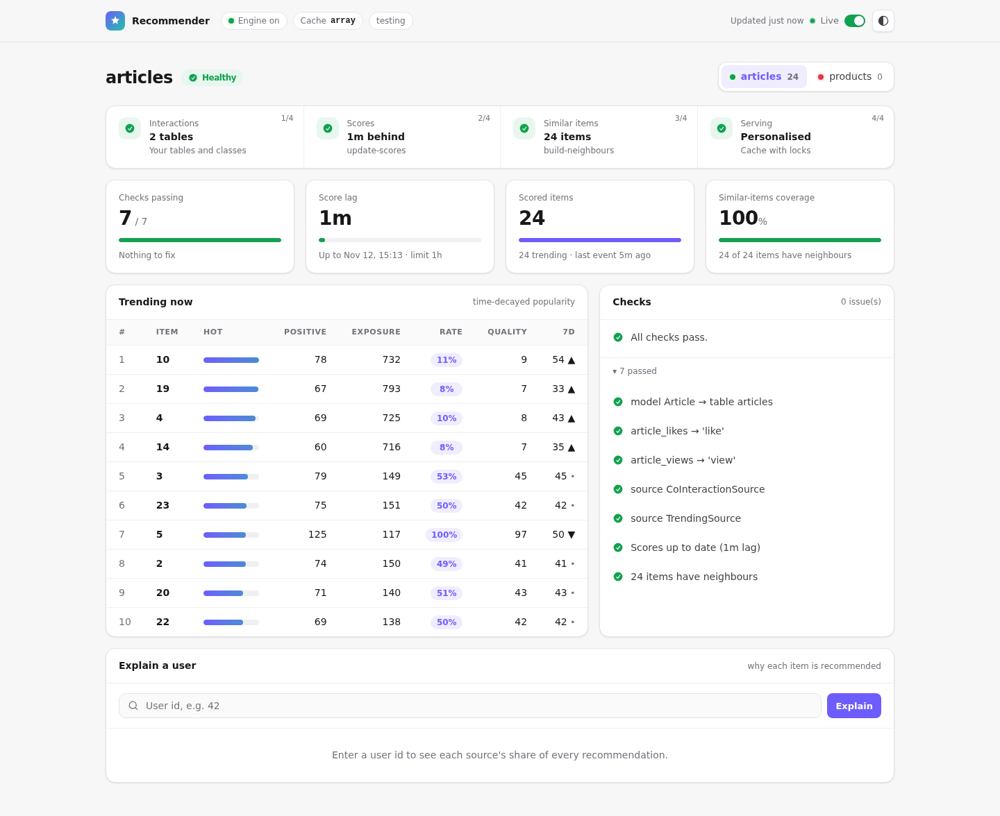
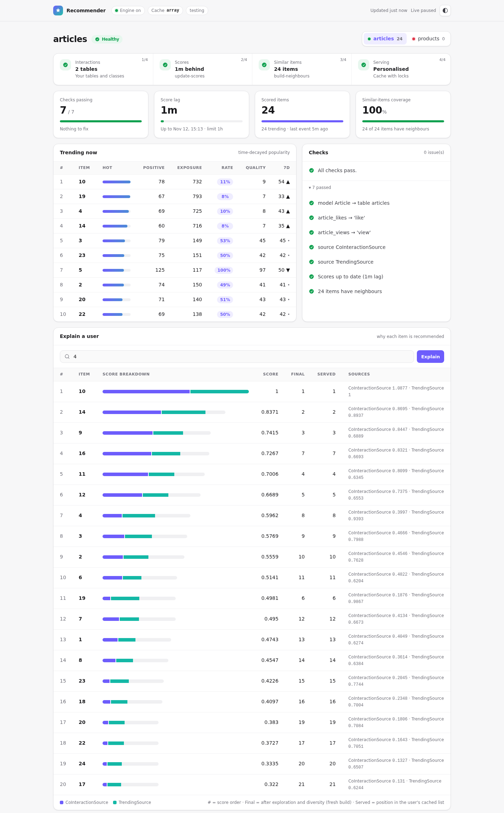
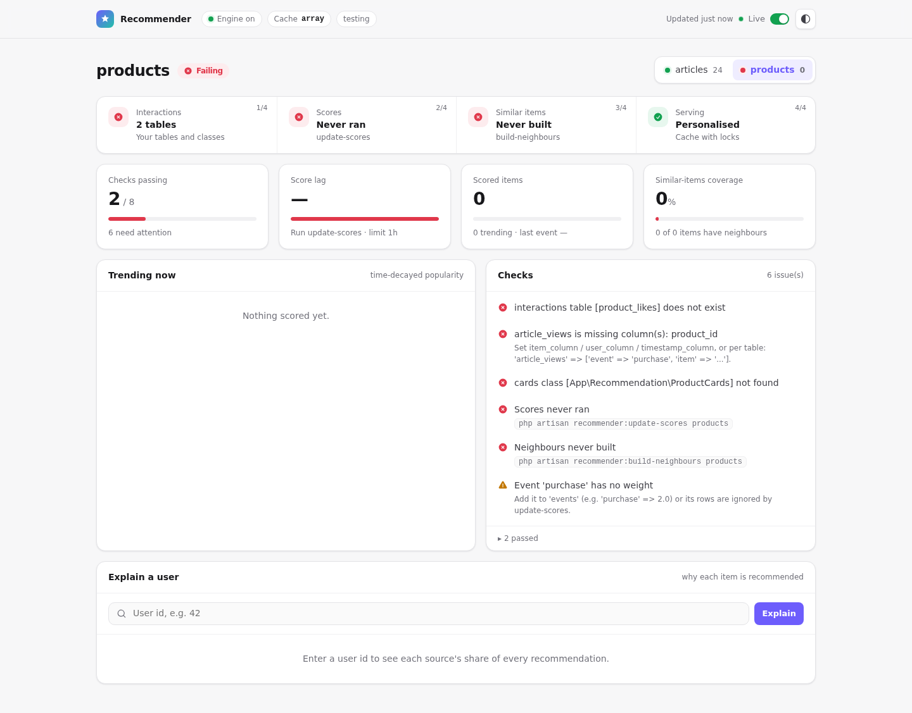
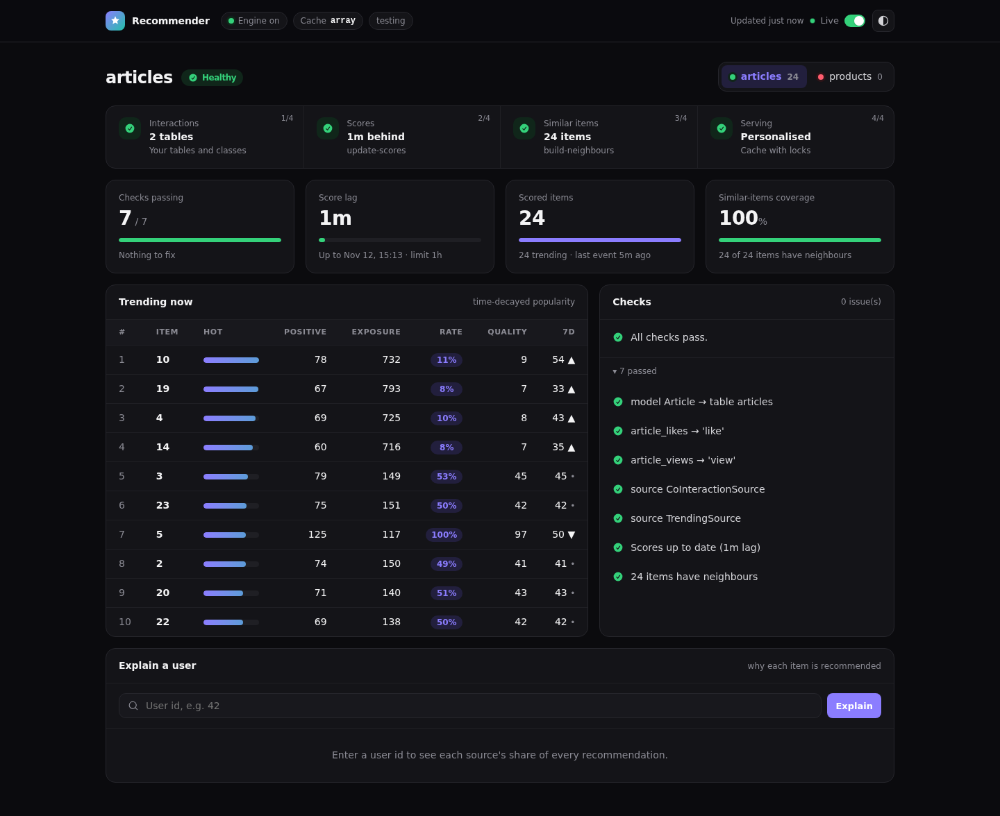
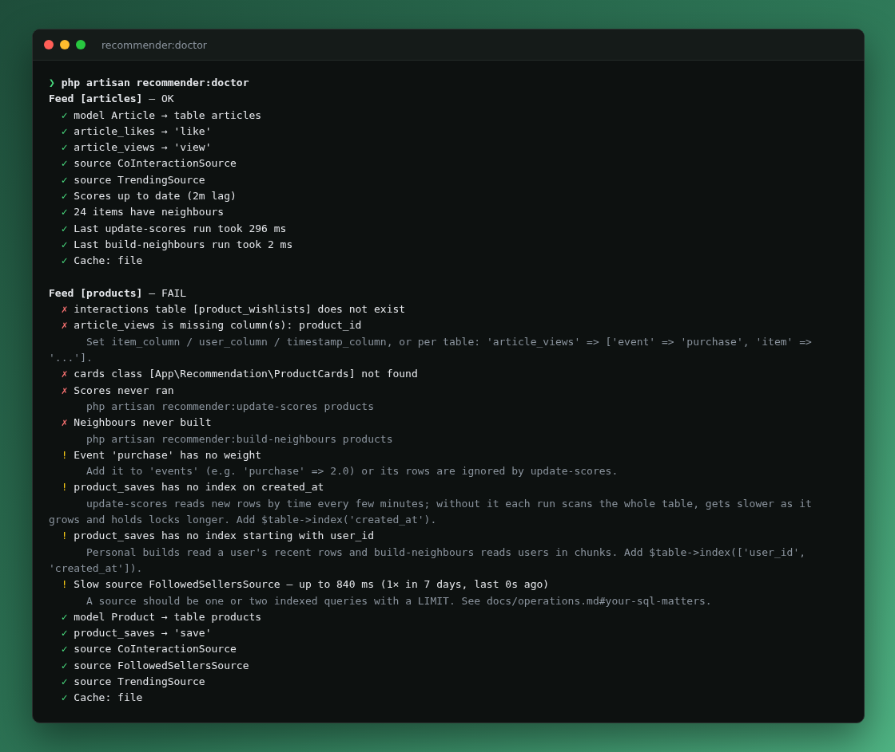
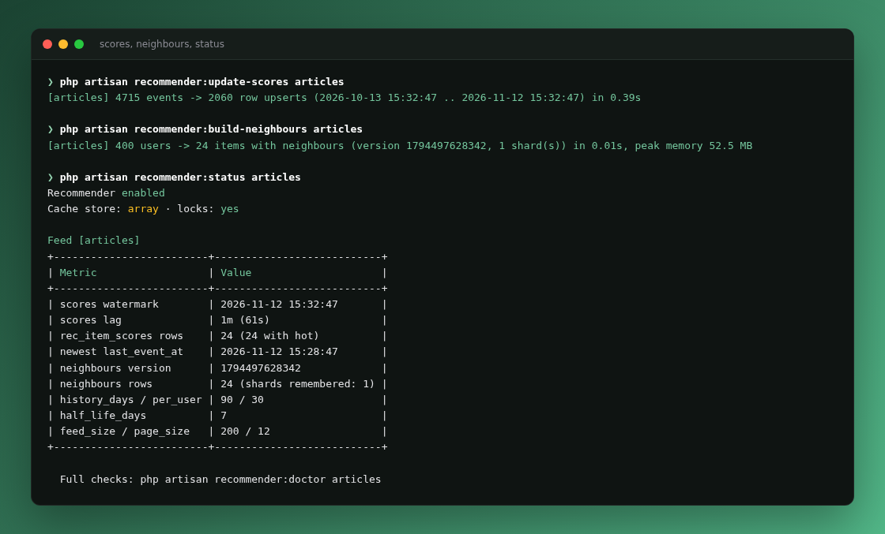
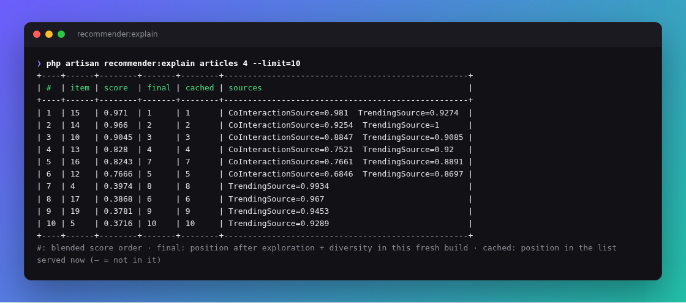

# Dashboard

One read-only page that answers “is the recommender healthy, and why does this user see that?”, in the same spirit as Laravel Horizon. It is plain Blade with no JavaScript build and no Livewire, refreshes itself every 10 seconds, and follows your system's light or dark theme (or toggle it).

```text
https://your-app.test/recommender
```



## What you see

| Area | Shows |
|---|---|
| Top bar | Engine on / kill switch, cache store (and whether it can lock), environment, time since the last update, the **Live** switch and the light / dark toggle. |
| Title & feed tabs | The feed's status (**Healthy / Warnings / Failing**) and, with several feeds, one tab per feed with its status dot and scored-item count. |
| Pipeline | The four steps a feed goes through — **Interactions → Scores → Similar items → Serving** — so you see at a glance *where* it is broken. |
| Cards | Checks passing, score lag against the 1-hour limit, scored items, and similar-items coverage (share of items that have neighbours). |
| Trending now | Top 10 items by time-decayed popularity, with positive (e.g. likes) and exposure (e.g. views) counts, their rate, **quality** (the rate adjusted for how much evidence there is, 0–100) and **7d** — quality this week with ▲ / ▼ against the last 30 days. |
| Checks | Problems first, each with its fix; passing checks fold away. |
| Explain a user | Enter a user id to see why each item is ranked, as a stacked bar of every source's share of the score. |

### Explain a user



Each bar is the item's score split by source (the parts add up to the score). **Final** is the item's position after exploration and diversity in this fresh build, and **Served** its position in the list the user gets right now — so you can tell a ranking question from a caching one. `CoInteractionSource` means “people who liked what this user liked also liked this”, and `TrendingSource` means “popular right now”. A user who only gets `TrendingSource` rows has too little history or no shared interactions yet. Exploration is shuffled on every build, so *Final* can move between runs. Live refresh pauses while a user is explained, so the build does not repeat.

### Checks



| Check | Fails / warns when |
|---|---|
| Model | `model` is not an Eloquent model, or its table does not exist |
| Interaction tables | a table is missing, or lacks its `id` / user / item / timestamp column |
| Event weights | an event in `interactions` has no weight in `events`; its rows would be ignored (warning) |
| Classes | a source, booster, filter, cards or groups class is missing or does not implement its contract |
| Cards | the feed has neither `model` nor `cards` |
| Scores | `update-scores` never ran, or is more than 1 hour behind (warning) |
| Neighbours | `build-neighbours` never ran, or produced an empty graph (warning) |
| Cache | the cache store cannot lock, so concurrent builds are last-write-wins (warning) |

Dark mode follows the operating system; the **Theme** button overrides it and is remembered:



## Access

Like Horizon, the page is open in the `local` environment. Everywhere else only users allowed by the `viewRecommender` gate can open it; everyone else gets a 403.

```php
// app/Providers/AppServiceProvider.php
use Illuminate\Support\Facades\Gate;

public function boot(): void
{
    Gate::define('viewRecommender', fn ($user) => in_array($user->email, [
        'ops@example.com',
    ]));
}
```

To require login first, add `auth` to the middleware (see below).

## Configuration

`config/recommender.php`:

```php
'dashboard' => [
    'enabled' => env('RECOMMENDER_DASHBOARD', true),
    'path' => env('RECOMMENDER_DASHBOARD_PATH', 'recommender'),
    'domain' => env('RECOMMENDER_DASHBOARD_DOMAIN'),
    'middleware' => ['web'],   // e.g. ['web', 'auth']; the gate is always applied
    'refresh' => 10,           // seconds between live updates, 0 = off
],
```

Set `RECOMMENDER_DASHBOARD=false` to remove the route entirely.

## Same checks in the terminal

```bash
php artisan recommender:doctor          # every feed
php artisan recommender:doctor posts    # one feed
```

It prints the same checks and exits with a non-zero code when any check fails, so you can run it in a deploy script or CI after migrations.



The jobs and `recommender:status` print what they did and the raw numbers:



And `recommender:explain` is the terminal version of **Explain a user**:


