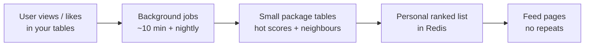
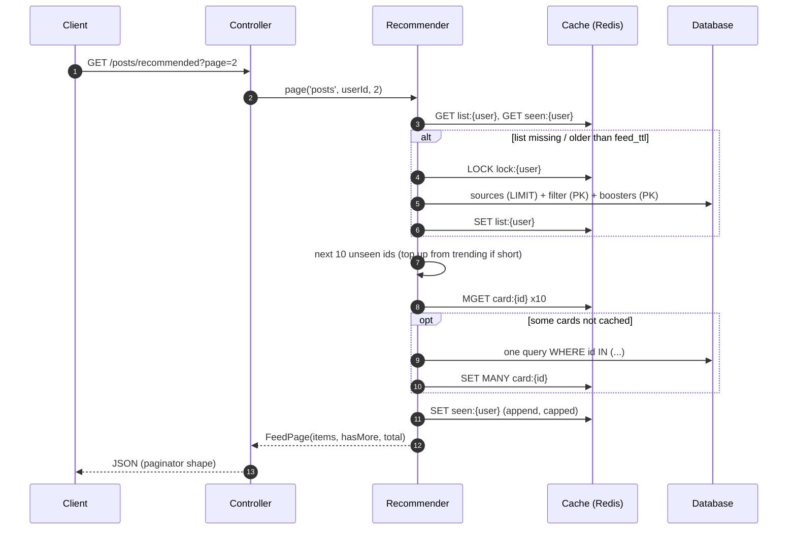
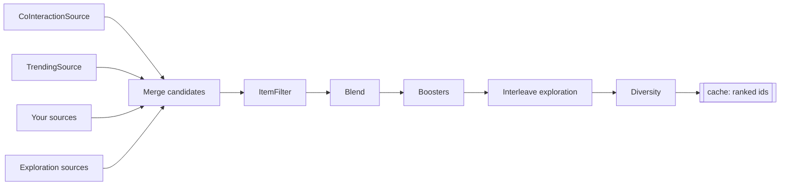

# How it works

## The big picture

1. Users **view / like** items in *your* tables — this package does not copy those rows.
2. Every **~10 minutes** a job updates a small “how hot is this item?” score.
3. **Once a night** another job stores “people who liked *this* also liked *what?*” (neighbours).
4. When they open “for you”, the package builds a personal ranked list, remembers what they saw, and serves the next page from cache.
5. **Guests / brand-new users** get a shared trending list until they have history.

One line: **signals in your tables → quiet background learning → personal next cards in Redis.**

| When | What happens |
|---|---|
| **Every scroll** | Slice the cached list; mark cards as seen |
| **~every 30 min per active user** | Rebuild that user’s list if stale |
| **~10 min / nightly / daily** | Scores, neighbours, prune |

During a list **build**, every custom source / booster / filter receives a **`Context`** (viewer id, feed config, clock) — not the HTTP request. See [reference.md → What is Context?](reference.md#what-is-context).

## A request, step by step

## How a feed is built

1. **Candidates** — each source returns up to `source_limit` ids (indexed SQL + `LIMIT`). A failing source is logged and skipped.
2. **Filter** — your `ItemFilter` gets *all* ids at once.
3. **Blend** — each source normalised to 0..1, then `Σ weight · score`.
4. **Boost** — e.g. Wilson quality; boosters only touch existing candidates.
5. **Explore** — ~15% slots from exploration sources so new content gets a chance.
6. **Diversify** — e.g. max 1 post per author per page; overflow slides to later pages.

## Two algorithms (short)

- **Item–item CF** — nightly neighbours; at request time score from the user’s recent items.  
- **Time-decayed `hot`** — stored in log space, updated with log-sum-exp so trending stays correct without replaying history.

Full formulas: [How we score (maths)](maths.md).
