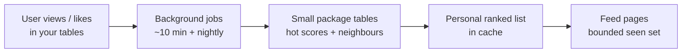
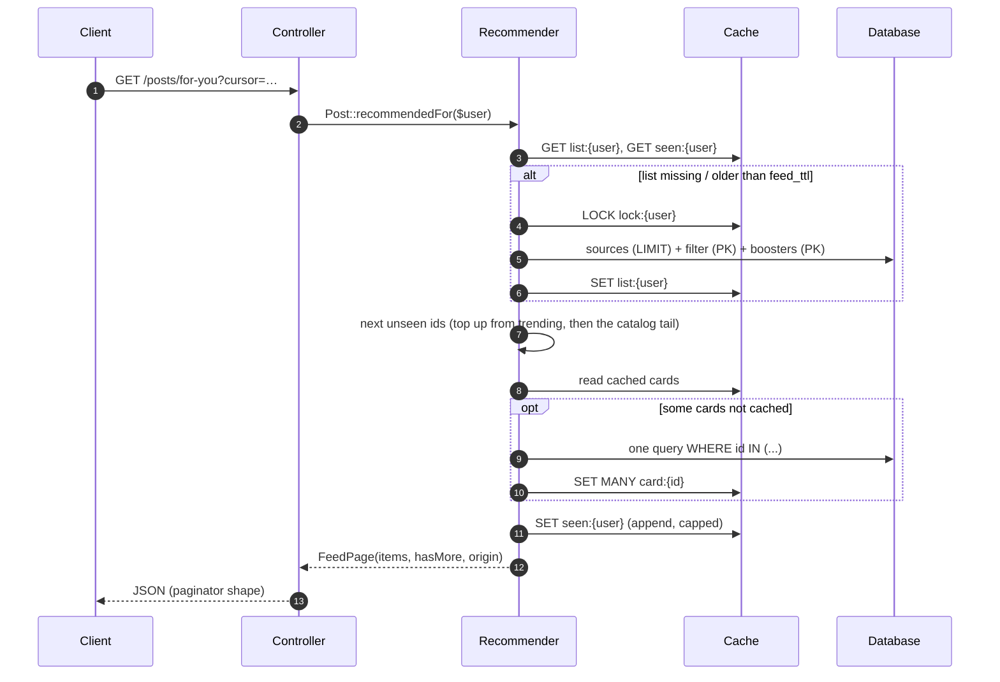
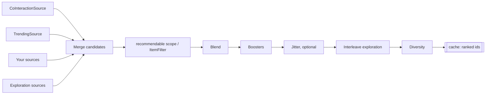

# How it works

## The big picture

1. Users **view / like** items in *your* tables — this package does not copy those rows.
2. Every **~10 minutes** a job updates a small “how hot is this item?” score.
3. **Once a night** another job stores “people who liked *this* also liked *what?*” (neighbours). The same neighbours also answer `$post->similar()` for related-posts blocks, read per item and cached.
4. When they open “for you”, the package builds a personal ranked list, remembers what they saw, and serves the next page from cache.
5. **Guests** get a shared trending list. A new user may receive trending candidates in a personal list.
6. When ranked and trending items run out, feeds with a `model` continue with the **newest** items the user may see (the catalog tail), so scrolling does not hit a wall.

One line: **signals in your tables → quiet background learning → personal next cards in your configured cache.**

| When | What happens |
|---|---|
| **Every scroll** | Slice the cached list; mark cards as seen |
| **~every 30 min per active user** | Rebuild that user’s list if stale |
| **~10 min / nightly / daily** | Scores, neighbours, prune — scheduled by the package |

During a list **build**, every custom source / booster / filter receives a **`Context`** (viewer id, feed config, clock) — not the HTTP request. See [reference.md → What is Context?](reference.md#what-is-context).

Your interaction tables remain the source of truth for activity. The seen set is a separate, temporary cache of item IDs **served**, including items the user did not click. It helps avoid repeats when the ranked list changes; it is not a permanent history. By default it is shared across a user's devices, holds at most 200 IDs per feed, and expires after three days without an update. Repeats are possible after expiry, eviction, reset, concurrency or the page-one fallback. Guests use offsets on the shared trending list. Cache misses and builds can query the database. See [seen memory and impressions](operations.md#seen-memory-and-impressions) for the trade-offs.

## A request, step by step

## How a feed is built

1. **Candidates** — each source returns up to `source_limit` ids (indexed SQL + `LIMIT`). A failing source is logged and skipped.
2. **Filter** — the model's `recommendable` scope (or your `ItemFilter`) checks *all* ids in one query.
3. **Blend** — each source normalised to 0..1, then `Σ weight · score`.
4. **Boost** — e.g. Wilson quality; boosters only touch existing candidates.
5. **Jitter** (optional, off by default) — `jitter` mixes a random draw into the order once per build; `1` gives a random order of the candidates. Never applied to the shared trending list.
6. **Explore** — `exploration_ratio` interleaves items from `exploration_sources` (the presets use trending).
7. **Diversify** — e.g. max 1 post per author per page; overflow slides to later pages.

## Two algorithms (short)

- **Item–item CF** — nightly neighbours; at request time score from the user’s recent items.  
- **Time-decayed `hot`** — stored in log space, updated with log-sum-exp so trending stays correct without replaying history.

Full formulas: [How we score (maths)](maths.md).
