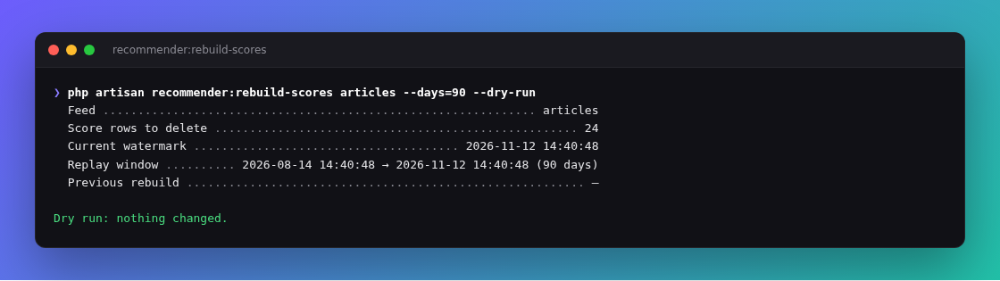

# Operations

Go-live, storage, locks, FAQ, what is still open.

## First-time go-live checklist

| Step | Action | Why |
|---|---|---|
| 1 | `php artisan migrate` | `rec_*` tables |
| 2 | Register a feed | `php artisan recommender:bootstrap posts` (or `make-feed` + the steps below) |
| 3 | Index your interaction / item tables | Sources are your SQL |
| 4 | `recommender:update-scores {feed}` | Fill `hot` / quality |
| 5 | `recommender:build-neighbours {feed}` | Fill graph |
| 6 | `recommender:doctor` and `recommender:explain {feed} {userId}` | All checks pass; expect personal sources |
| 7 | Run Laravel's scheduler | The package schedules its three jobs itself ([reference](reference.md#background-jobs)) |
| 8 | Cache with locks (`redis` or `database`+`cache_locks`) + `queue:work --queue=recommender` | Build locks + warm builds |
| 9 | `Gate::define('viewRecommender', …)` | Dashboard at `/recommender` in production |

### Historical imports and score rebuilds

The first score run reads `scores_backfill_days` (default 30); later runs start at the stored watermark. Increasing the setting after a run does not revisit older events. Likewise, changing event weights or half-life does not recalculate past scores.

To recompute one feed from scratch — after importing old interactions, or changing event weights or `half_life_days` — use the guided command:

```bash
php artisan recommender:rebuild-scores posts --days=365 --dry-run   # what would happen
php artisan recommender:rebuild-scores posts --days=365             # asks for confirmation (--force to skip)
```



It deletes only that feed's score rows and watermark, replays the window, and refreshes trending. It never double-counts: a marker is written first, and while it exists `update-scores` refuses that feed (other feeds keep updating). If the rebuild is interrupted, `recommender:doctor` and the dashboard show it — run the same command again to finish. Rebuild neighbours separately if `history_days` changed; cached user lists refresh within `feed_ttl`. Expect temporarily missing scores for the feed while it runs, so prefer a quiet hour for long windows.

### Livewire / HTTP `Artisan::call`

Commands register outside CLI so Ops panels work. Prefer queued jobs in production.

## Publishing a package release

GitHub Releases are automated: push a `v*.*.*` tag → [`.github/workflows/release.yml`](../.github/workflows/release.yml) creates/updates the Release using the matching `## [x.y.z]` section from [`CHANGELOG.md`](../CHANGELOG.md).

1. Move notes out of `## [Unreleased]` into a new `## [x.y.z] — YYYY-MM-DD` section (Keep a Changelog).
2. Add upgrade steps to [`UPGRADE.md`](../UPGRADE.md) for anything that changes behaviour, and bump `extra.branch-alias` in `composer.json` on a new minor (e.g. `0.11.x-dev`).
3. Commit on `main`, wait for [tests](../.github/workflows/tests.yml) to go green.
4. Tag and push:

```bash
git tag -a v0.10.4 -m "v0.10.4"
git push origin main
git push origin v0.10.4
```

5. Confirm the Release on GitHub (notes = that CHANGELOG section). Re-run from **Actions → release → Run workflow** if you only need to refresh notes for an existing tag.

A Git tag triggers the workflow; check that the corresponding GitHub Release was created successfully.

## Day-to-day ops

| Task | How |
|---|---|
| Switch the package off | `RECOMMENDER_ENABLED=false` — trending only, no writes, jobs paused ([details](reference.md#turning-it-on-and-off)) |
| Switch one feed off | `'enabled' => false` on the feed |
| Flush cache | Delete keys `rec:*` (or your prefix) |
| Reset one user | `Recommender::forgetUser('posts', $id)` |
| Debug ranking | `recommender:explain posts 123` |
| Health | `recommender:status` / `recommender:status posts` |
| Rebuild similarities | `recommender:build-neighbours posts` |
| Recompute scores | `recommender:rebuild-scores posts --days=…` ([details](#historical-imports-and-score-rebuilds)) |
| Check everything | `recommender:doctor` or the `/recommender` dashboard |
| Neighbour memory guard | Retries with more shards; raise budget or lower `history_per_user` |

Source and build failures are logged and can fall back to trending. Other failures (for example a missing feed or card transformer) may still surface; check application logs.

## What is stored where

Package **never copies** your interaction rows (likes / views / shares / …). Four derived tables + cache:

| Store | Holds | Grows with | Bounded by |
|---|---|---|---|
| `rec_item_scores` | `hot`, counters, impressions | recently active / shown items | `prune` + retention |
| `rec_item_daily` | per-day positive / exposure / impressions (quality over time) | active items × days | `prune` + retention |
| `rec_item_neighbours` | top-N similar ids (feeds and `similar()`) | items with neighbours | versioned rebuild |
| `rec_state` | watermarks, versions | handful of keys | overwrite |
| Cache store (redis / database / …) | lists, seen, cards, locks, `similar()` id lists | active users, items and configured variants | TTLs and cache eviction |

Actual storage depends on database indexes, ID length, cache driver and serialization. Measure with representative data; cache can also use the database store. See below for the seen-set estimate.

## Seen memory and impressions

**Why remember seen items?** Your app's interaction tables remain the source of truth for likes and views. They do not necessarily say which items were returned on a feed page. For each signed-in user and feed, the package keeps a temporary list of served item IDs in the configured Laravel cache store. It normally skips those IDs when the ranking changes or the user loads another page, even across devices. This is a serving aid, not a permanent interaction history. Guests do not have a seen-set.

By default `seen_max` is 200 IDs and `seen_ttl` is 259200 seconds (three days). Each nonempty update refreshes the TTL for the whole set, while the cap removes older IDs. Expiry, eviction, `forgetUser()`, a full set, concurrent requests, or the page-one fallback can bring an item back. With `list_vary_by` containing `tenant`, seen state is separated per tenant by default; `seen_vary_by` can change that. Configure candidate-changing attributes and authorization separately as explained in [advanced usage](advanced.md#passing-extra-context).

For example, 200 six-digit numeric IDs pack into roughly 1.4 KB of ID text; 50,000 full sets would be about 70 MB of text alone. This is **not a Redis memory quote**: keys, serialization, allocator overhead, ID lengths (UUIDs are longer), feeds, variants, cached lists and cards all add to it. Measure your actual cache store. A database cache stores these entries in database tables, while a local cache is not shared across servers. Lower `seen_max` or `seen_ttl` to reduce retained state, accepting more repeats. Each page also reads and updates cache state and may acquire a lock; latency depends on the store and traffic.

**Should I enable impressions?** They are off by default. Turn on `'impressions' => true` only when you want quality based on items served, and measure the additional load. For signed-in users, impressions reuse the seen-set to approximate the first serve per item within that bounded window. Guest pages are not counted unless `'impressions_guests' => true`; then each served item counts on each page, with no de-duplication, so rate-limit the guest route. Retries can serve new items; cache loss, lock timeouts or eviction can lead to duplicate counts, and failed writes can lose counts. This is not a billing or audit ledger.

A nonempty impression batch issues two bulk `UPDATE` statements, on `rec_item_scores` and `rec_item_daily`, plus a lookup, an insert and another update per table for items that have no row there yet. HTTP requests schedule the writes on Laravel's terminating callback by default; console calls or `'impressions_after_response' => false` write inline. Deferred work still uses worker and database capacity. The daily table grows with active **feed × item × day** combinations, not users; score rows also store impression counters. The scheduled `recommender:prune` deletes daily rows older than `scores_retention_days` (180 by default) and removes idle score rows subject to their last activity. Run Laravel's scheduler, or run prune yourself if scheduling is disabled. See [impressions in the reference](reference.md#impressions-shown-not-just-viewed).

## Deadlocks & overlapping runs

| Concern | Handling |
|---|---|
| Two score jobs | `withoutOverlapping()`; short per-slice transactions |
| Score job vs live traffic | Serving reads cache; builds and opt-in impression writes can access `rec_*` |
| Neighbour mid-request | New version → activate → chunked delete of old |
| Two builds same user | Cache lock when store supports `LockProvider`; otherwise unlocked fallback (last write wins) |
| Many users at once on the **database** cache | One cache row per user and key, so users do not block each other; the same user in two tabs is serialised by a lock; a failed seen-list write never fails the page |
| Impression writes on hot items | Increment existing rows first, in sorted key order (no lock-order or shared-lock upgrade deadlocks), one statement per commit, retried on deadlock; written after the response |
| Score job vs impression writes | Both touch rows in the same sorted order |
| Warm pile-up | `BuildFeed` `ShouldBeUnique` |
| App-table deadlocks | Jobs only **SELECT** your interaction tables |

Crash mid-slice: watermark / version activation → resume cleanly, no double-count.

Verified under real concurrency: 0 deadlocks and 0 errors up to 48 processes on the database cache (before the 0.8.2 fix: 213 deadlocks in 1,800 pages). All numbers: [performance](performance.md).

## Memory

| Path | Behaviour |
|---|---|
| HTTP `page()` | Cache reads and seen update plus card queries; a miss can trigger a build; optional impressions write on termination |
| `update-scores` | one time slice |
| `build-neighbours` | shards; abort/retry under memory budget |
| `prune` | `delete_chunk` id lists |

Tight host: lower `history_*`, raise shards, shorten `scores_slice_minutes`.

## At 100× data

| Part | Grows with | At 100× |
|---|---|---|
| Request | cache state and page size | cache reads, card fetches, and occasional feed builds |
| Feed build | active users | more builds, same size each |
| `update-scores` | events / 10 min | bigger slices |
| `build-neighbours` | users × capped history | more shards |
| Cache (lists + seen) | active users, ID sizes, feeds and variants | measure on the configured cache store |

Writes are always bulk (`write_chunk` / `delete_chunk`). Asserted in `tests/Feature/ScaleTest.php`.

### Your SQL matters

A custom source that wants the newest items of 30 owners (e.g. the shops or authors a user follows), measured on MariaDB 10.11 with 1M rows:

| Query | Time |
|---|---|
| `WHERE owner_id IN (…) ORDER BY created_at DESC LIMIT 200` | ~470 ms |
| Same + index still sorts every row | ~468 ms |
| `UNION ALL` of 30 × `(owner_id = ? … LIMIT 14)` | **~3.6 ms** |

## FAQ

**Better than AWS Personalize?**  
Not as pure ML. For sparse likes/views, item–item + rules is a proven baseline: no per-request cloud cost, likes count in ~10 min, explainable cards.

**Slow DB when data grows?**  
Request path doesn’t rank in SQL. Jobs are windowed, bulk, memory-guarded.

**Laravel Octane?**  
Works, nothing to configure. The package keeps no per-request state in statics; `Recommender` is a scoped binding, so each request (and each queue job) gets a fresh one that reads the current config. Impressions are written in Octane's terminate step, after the response is sent. `tests/Feature/OctaneTest.php` runs the feed through an Octane-style worker loop.

**Need Redis?**  
No, and you do not have to choose: if your app has a working Redis store the package uses it automatically, otherwise your normal cache. The **database** cache is comfortable for small and medium apps (roughly tens of thousands of daily active users); `recommender:prune` keeps its table from growing. For heavy traffic add Redis to the app — no package change needed. See [reference → Cache](reference.md#cache-store--locks).

**Will it deadlock under heavy load?**  
Tested, not assumed: see the deadlocks table above and [performance](performance.md).

**Will `build-neighbours` OOM?**  
Shards + retry; previous graph stays live.

**How often to update?**  
Scores ~10 min, neighbours nightly, prune daily.

**A/B test?**  
Controller chooses who gets `Recommender::page()`.

**Add a learned model later?**  
Implement `CandidateSource` + weight.

**Everyone gets the same items?**  
Personal sources weigh too little next to trending / fresh sources or `exploration_ratio`, or neighbours are missing (see the next question). See [tuning](tuning.md).

**No CoInteraction in explain?**  
Neighbours never built / history short / `neighbours_min_co_count` too high.

**Imported old events, still empty?**  
The initial window defaults to 30 days. Widen it before the first run, or run `recommender:rebuild-scores {feed} --days=…`.

**Related posts / "you may also like"?**
`$post->similar(6)` reads the nightly neighbours, the same for every viewer and cached per item, so it does not grow with users. After `build-neighbours` it switches to the new version at once. New items have no neighbours yet: hide the block or fall back to your own query. See [reference → similar items](reference.md#similar-items-related-posts).

**Infinite feed?**  
Feeds with a `model` can continue from ranked items to trending and then the newest eligible items (`'tail' => true`, the default). Clients can follow `next_cursor`. Personal paging normally excludes IDs in the bounded seen-set; increasing `seen_max` can reduce repeats during longer sessions, at a cache cost. Empty pages and repeats remain possible.

## Limitations

- Item-to-item collaborative filtering out of the box (add other models as sources)
