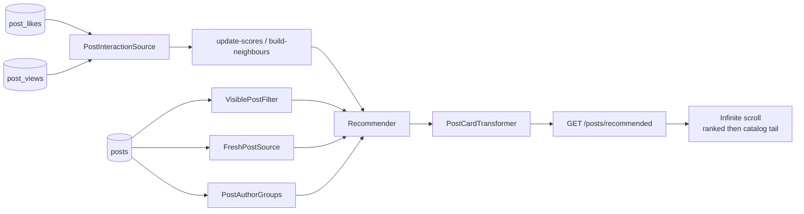

# Example: recommended blog posts

This is a complete, minimal integration: "recommended posts" for a blog that already records likes and views. It's the code from the main README's [Quick start](../../README.md#quick-start-5-steps), and it's tested end to end by [`tests/Feature/BlogExampleTest.php`](../../tests/Feature/BlogExampleTest.php).

Patterns below also reflect lessons from a real **inspiration / reviews** lab (pet-a-hood-sized data): infinite scroll, freshness vs personalisation, media posters, first-time jobs.



| File | Step | What it shows |
|---|---|---|
| `database/migrations/…_create_blog_example_tables.php` | – | The tables a typical app already has (`posts`, `post_likes`, `post_views`) |
| `src/PostInteractionSource.php` | 1 | Reading existing likes/views in bulk (`lazyById`, user-id ranges) |
| `src/VisiblePostFilter.php` | 2 | Business rules: published, not my own posts, one query |
| `src/PostCardTransformer.php` | 3 | API card per post (shared cache; media/poster note) |
| `config/recommender.php` | 4 | Feed weights + sizes (lab-tuned comments) |
| `src/RecommendedPostsController.php` | 5 | Serving pages in Laravel's paginator JSON shape |
| `src/FreshPostSource.php` | optional | Guest/empty-score fallback only (not “latest first”) |
| `src/FreshnessBooster.php` | optional | Prefer newer candidates — **omit by default**; large weight collapses cohorts |
| `src/PostAuthorGroups.php` | optional | "At most 1 post per author per page" |
| `src/InfiniteScrollFeed.php` | app UX | Ranked batches → chronological **catalog tail** until empty |
| `src/SponsoredShopSource.php` | campaign | Inject posts from `sponsored_author_ids` / shop ids |
| `src/SponsoredShopBooster.php` | campaign | Boost those candidates in the blend (use with diversity caps) |

## Try it

```bash
vendor/bin/pest tests/Feature/BlogExampleTest.php
```

The test:
1. Seeds 12 posts (post 3 unpublished, post 4 by user 1).
2. Seeds co-likes so user 1 should see post 2 early.
3. Runs `recommender:update-scores` + `recommender:build-neighbours`.
4. Asserts filters, no repeats, guests get trending.

## Use it in your app

1. Copy `src/*` into `app/Recommendation/Posts` and adjust the namespace.
2. Copy `config/recommender.php` into your app's `config/`.
3. Add the route for `RecommendedPostsController`.
4. Schedule `update-scores` / `build-neighbours` / `prune` (main README).
5. Run the two jobs **once** before go-live.

## Lab ideas worth copying

### 1. Infinite scroll (2-column, until no more)

`Recommender::page()` alone is **long, not infinite** (`feed_size` + `trending_size`, then `seen_max` recycle). For an app feed that scrolls until the catalog ends:

1. Keep calling `page()` and append cards (Livewire `wire:intersect` / Inertia).
2. When `hasMore` is false, call a chronological query of **visible** items excluding already-shown ids (cursor on `created_at, id`).

Helper: [`InfiniteScrollFeed`](src/InfiniteScrollFeed.php). UI: 2-column CSS grid + sentinel at the bottom.

### 2. Latest is not the goal

Lab default: **do not** optimise for newest comments/posts. High `Fresh*` / `FreshnessBooster` makes every cohort look the same. Prefer co-interaction + your domain sources + modest trending; keep fresh only as a guest fallback. Recipes: [Fine-tuning weights](../../README.md#fine-tuning-weights).

### 3. Cards & media

Cached cards must stay viewer-agnostic. If covers can be `.mp4`, resolve a **poster URL** in the transformer (don’t put video URLs in ``).

### 4. First-time / historical data

Empty CoInteraction in `explain` ⇒ neighbours never built or history too short. After importing old events, widen `scores_backfill_days` (or reset watermark) then rebuild neighbours. Checklist: [First-time go-live](../../README.md#first-time-go-live-checklist).

### 5. Source SQL

Avoid `WHERE user_id IN (SELECT … tens of thousands)`. Prefer joins / bounded `LIMIT`s. Don’t load multi-thousand-id JSON blobs just to `array_slice(0, 20)`.

### 6. Sponsored shops / campaign placement

Fill `sponsored_author_ids` (this blog example) or `sponsored_shop_ids` (reviews / BU feeds):

1. **`SponsoredShopSource`** — inject recent items from those ids into the candidate pool  
2. **`SponsoredShopBooster`** — raise their blend score  
3. Keep **`diversity`** (e.g. max 1–2 per author/shop per page) so one sponsor cannot own the screen  

Booster alone only helps items already in the pool; Source + Booster is the usual paid pattern.

### 7. Maths you can show stakeholders

Item–item CF, Wilson quality, half-life `hot` + log-sum-exp — [Ideas & maths](../../README.md#ideas--maths).

## Related

- Main README: setup, fine-tune, inspiration lessons, wishlist (`recommender:bootstrap`, presets, catalog tail in-package).
- [`AGENTS.md`](../../AGENTS.md) for agents integrating the package.
