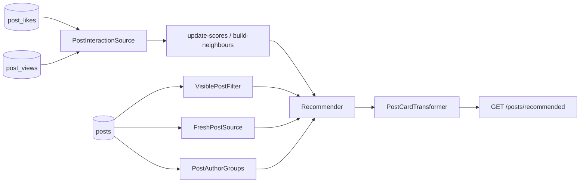

# Example: recommended blog posts

Minimal integration: likes + views → recommended posts. Covered by [`BlogExampleTest`](../../tests/Feature/BlogExampleTest.php).

**First time with the package?** Start at [docs/getting-started.md](../../docs/getting-started.md), then come back here to copy files.



| File | Role |
|---|---|
| `src/PostInteractionSource.php` | Stream likes/views |
| `src/VisiblePostFilter.php` | Published, not mine — one query |
| `src/PostCardTransformer.php` | API card (shared cache) |
| `config/recommender.php` | Feed weights |
| `src/RecommendedPostsController.php` | `toPaginatorArray()` JSON |
| `src/FreshPostSource.php` | Guest / empty-score fallback |
| `src/PostAuthorGroups.php` | Max 1 author per page |
| `src/InfiniteScrollFeed.php` | Ranked batches → catalog tail |
| `src/SponsoredShopSource.php` + `Booster` | Campaign placement |

## Try it

```bash
vendor/bin/pest tests/Feature/BlogExampleTest.php
```

## Use in your app

1. Copy `src/*` → `app/Recommendation/Posts` (fix namespaces).
2. Merge `config/recommender.php`.
3. Add the route.
4. Schedule jobs — [getting started](../../docs/getting-started.md#step-4--schedule-the-kitchen).
5. Run `update-scores` + `build-neighbours` once before go-live.

## Lab ideas

- **Infinite scroll** — ranked then chronological tail: `InfiniteScrollFeed`.
- **Don’t optimise for “latest”** — high Fresh\* collapses cohorts: [tuning](../../docs/tuning.md).
- **Video covers** — poster URL in the transformer, not `.mp4` in ``.
- **Sponsors** — Source + Booster + diversity caps.
- **How we score** — [How we score (maths)](../../docs/maths.md).
