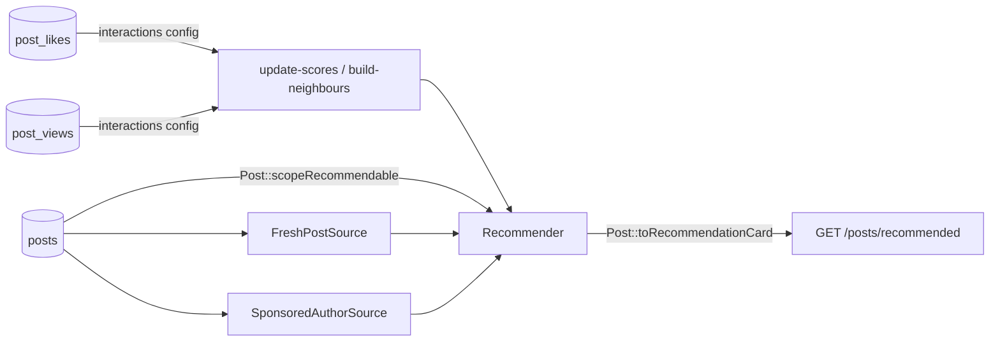

# Example: recommended blog posts

Likes + views → recommended posts, with a sponsored-author campaign and one post per author per page. Covered by [`BlogExampleTest`](../../tests/Feature/BlogExampleTest.php).

Also see: [`../simple`](../simple/) (smallest feed) · [`../products`](../products/) (three events) · [`../reviews`](../reviews/) (custom sources) · [index](../README.md).



| Path | Role |
|---|---|
| `config/recommender.php` | The feed: `model`, `interactions`, weights, `'diversity' => ['author_id' => 1]` |
| `src/Models/Post.php` | Visibility (published, not mine) + card |
| `src/Sources/` | Fresh posts (guests) + sponsored posts |
| `src/Boosters/` | Freshness (not wired in the config) + sponsored |
| `src/Http/` | One-line controller |

## Try it

```bash
vendor/bin/pest tests/Feature/BlogExampleTest.php
```

## Use in your app

1. Merge the feed from `config/recommender.php` into yours (`model` → your model class).
2. Copy the model's `scopeRecommendable()` and `toRecommendationCard()` into your model, and add `use Recommendable;`.
3. Route: `Route::get('/posts/recommended', fn (Request $r) => Post::recommendedFor($r->user()));`
4. Related posts on a post page: `$post->similar(4)` (cards of the posts liked together with this one; empty until `build-neighbours` found any)
5. Check it: `php artisan recommender:doctor posts`. The scoring jobs are scheduled by the package — keep Laravel's scheduler running.

## Ideas to try

- **Infinite scroll** — built in: ranked, then trending, then the newest posts (`'tail'`), following `next_cursor`.
- **Don’t optimise for “latest”** — a high `FreshPostSource` weight shows every user the same new posts: [tuning](../../docs/tuning.md).
- **Sponsors** — `SponsoredAuthorSource` + `SponsoredAuthorBooster` (`sponsored_author_ids`) + diversity caps.
- **How we score** — [How we score (maths)](../../docs/maths.md).
