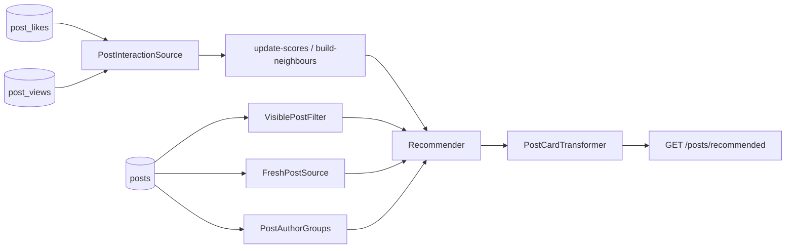

# Example: recommended blog posts

This is a complete, minimal integration: "recommended posts" for a blog that already records likes and views. It's the code from the main README's [Quick start](../../README.md#quick-start-5-steps), and it's tested end to end by [`tests/Feature/BlogExampleTest.php`](../../tests/Feature/BlogExampleTest.php).



| File | Step | What it shows |
|---|---|---|
| `database/migrations/…_create_blog_example_tables.php` | – | The tables a typical app already has (`posts`, `post_likes`, `post_views`) |
| `src/PostInteractionSource.php` | 1 | Reading existing likes/views in bulk (`lazyById`, user-id ranges) |
| `src/VisiblePostFilter.php` | 2 | Business rules: published, not my own posts, one query |
| `src/PostCardTransformer.php` | 3 | API card per post (shared cache, so no viewer-specific fields) |
| `config/recommender.php` | 4 | The feed: sources and weights, booster, exploration, diversity |
| `src/RecommendedPostsController.php` | 5 | Serving pages in Laravel's paginator JSON shape |
| `src/FreshPostSource.php` | optional | Your own candidate source |
| `src/PostAuthorGroups.php` | optional | "At most 1 post per author per page" |

## Try it

Run the example's test:

```bash
vendor/bin/pest tests/Feature/BlogExampleTest.php
```

The test does the following:
1. Seeds 12 posts. Post 3 is unpublished and post 4 is written by user 1.
2. Seeds users 2–20 liking posts 1 and 2 together, and user 1 liking post 1.
3. Runs `recommender:update-scores` and `recommender:build-neighbours`.
4. Calls `GET /posts/recommended` and checks the results:
   - user 1 gets **post 2 first**, because it was liked together with post 1
   - post 3 (unpublished) and post 4 (user 1's own) never appear
   - pages don't repeat
   - guests get the trending list

## Use it in your app

1. Copy `src/*` into `app/Recommendation/Posts` and adjust the namespace.
2. Copy `config/recommender.php` into your app's `config/`.
3. Add the route:
   ```php
   Route::get('/posts/recommended', RecommendedPostsController::class);
   ```
4. Add the three scheduler entries from the main README.
5. Run the two jobs once to fill the tables.
