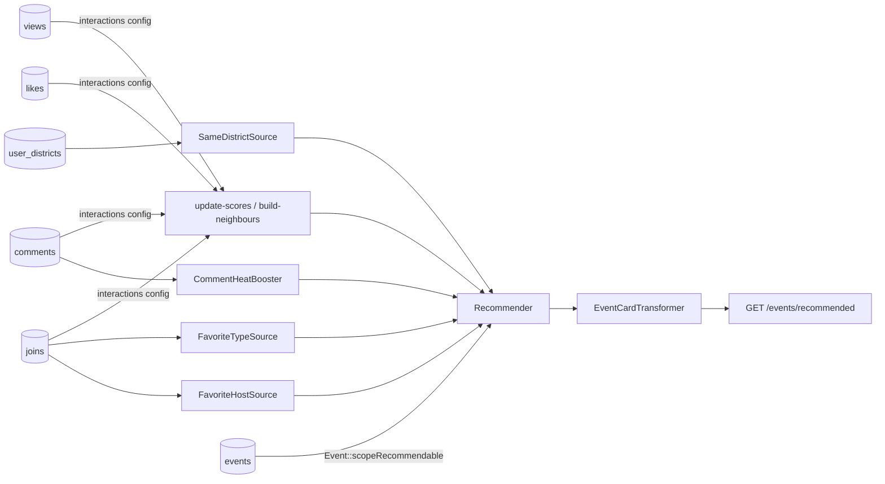

# Example: advanced events

Builds on [`../events`](../events/) (view / like / join → recommended events, config-only), **plus** product rules so **district**, **hosting party**, **event type**, and **comments** all shape the ranking.

If you only need the simple feed, use [`../events`](../events/) instead.

| Signal | Affects recommendation? | How |
|---|---|---|
| Event `district_id` + user living district | Yes | `SameDistrictSource` |
| Event `host_id` (party / organiser) | Yes | `FavoriteHostSource` + `PreferredHostBooster` (most-joined hosts) |
| Event `type_id` | Yes | `FavoriteTypeSource` + `PreferredTypeBooster` (most-joined types) |
| Comments (`event_comments`) | Yes | `comment` interaction (trending + CF) + `CommentHeatBooster` (busy threads) |
| view / like / join | Yes | Same as events (`join` strongest; `comment` between like and join) |

Covered by [`EventsAdvancedExampleTest`](../../tests/Feature/EventsAdvancedExampleTest.php).



## Tables

Same as the events example, with extras:

| Table / column | Role |
|---|---|
| `events.host_id` | Hosting party / organiser |
| `events.district_id` / `type_id` | Location + category |
| `event_views` / `_likes` / `_joins` | Same as events |
| `event_comments` | Discussion — each row is a `comment` event |
| `user_districts` | Where the user lives |

## Try it

```bash
vendor/bin/pest tests/Feature/EventsAdvancedExampleTest.php
```

## Layout

```
config/recommender.php   # model + 4 interaction tables + weights; diversity by host_id / district_id / type_id
src/
  Models/Event.php        # scopeRecommendable(Context) = published + upcoming + not own host
  Sources/                # SameDistrict, FavoriteType, FavoriteHost, Fresh
  Boosters/               # PreferredType, PreferredHost, CommentHeat
  Cards/EventCardTransformer.php   # custom: adds comment_count with one grouped query
  Http/RecommendedEventsController.php
  Support/JoinPreferences.php
```

Interactions, visibility and diversity come from config and the model. The card stays a class on purpose: it needs comment counts for every event at once, which a per-model `toRecommendationCard()` would turn into one query per event. A `cards` class always wins over the model.

## Write sources like English

Custom sources return floats; the blender normalises them. This example uses:

| Piece | Role |
|---|---|
| `Event::recommendable($context)` | published + upcoming + not own host (also used by the sources) |
| `JoinPreferences::types()` / `hosts()` | “what this user joins most” |
| `Math::scoreInOrder($events)` | ordered query → scores |
| `Math::scoreInOrder($events, fn ($e) => $weight)` | affinity × soft order |
| `Math::preferRanked(...)` | booster for favorite type/host |
| `Math::normalizeMax(...)` | comment heat scaled to max = 1 |

Full guide: [docs/maths.md §5](../../docs/maths.md). Tune **config source weights** before changing formulas.

## Use in your app

1. Copy `src/` folders → `app/Recommendation/Events`, and the model's scopes into your `Event` model.
2. Merge feed `events` into `config/recommender.php` and run `php artisan recommender:doctor events`.
3. Map `host_id` / `district_id` / `type_id` / comments to your schema.
4. Tune weights: raise district for local apps, host for organiser loyalty, type for taste, `comment` / `CommentHeatBooster` when discussion matters.
