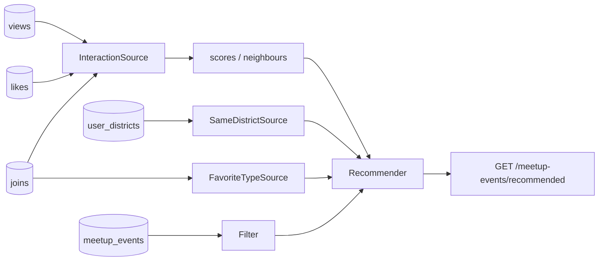

# Example: advanced events (district + type affinity)

Builds on [`../events`](../events/) with **product rules** on top of view / like / join:

| Signal | How we use it |
|---|---|
| Event `district_id` + user living district | `SameDistrictSource` |
| Event `type_id` + user’s most-joined types | `FavoriteTypeSource` |
| Join count per type | Favorite types ranked by join frequency |
| view / like / join | Same as basic events (`join` strongest) |

Covered by [`EventsAdvancedExampleTest`](../../tests/Feature/EventsAdvancedExampleTest.php).



## Tables (example)

| Table | Role |
|---|---|
| `meetup_events` | Items (`district_id`, `type_id`, `host_id`, `starts_at`) |
| `meetup_event_views` / `_likes` / `_joins` | Interactions |
| `user_districts` | Where the user lives (`district_id`) |

Event types are integers in this sample (`1` = outdoor, `2` = workshop, …) — replace with your enum / FK.

## Try it

```bash
vendor/bin/pest tests/Feature/EventsAdvancedExampleTest.php
```

## Use in your app

1. Copy `src/*` → `app/Recommendation/MeetupEvents` (or merge into your Events namespace).
2. Merge feed `meetup_events` into `config/recommender.php`.
3. Point district / type columns at your real schema.
4. Tune weights: raise `SameDistrictSource` for local apps; raise `FavoriteTypeSource` when taste matters more than location.
