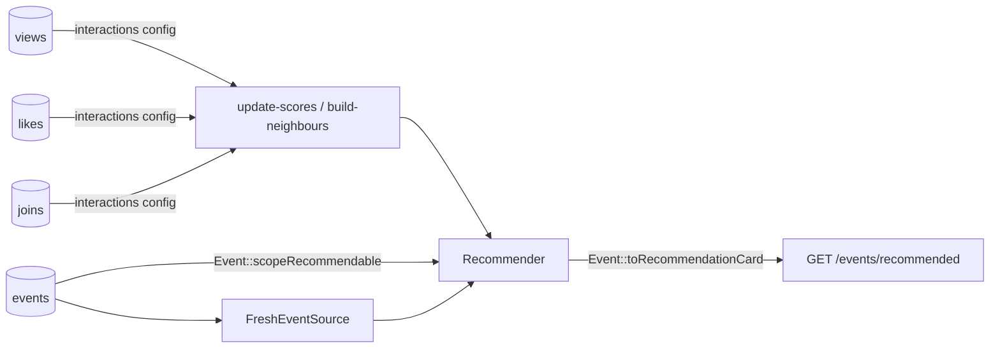

# Example: recommended events listing

Meetup / community **events** people can **view**, **like**, and **join** (RSVP). The feed recommends upcoming (or recent) events for a user — not `ORDER BY RAND()`.

| Table | Event | Default weight |
|---|---|---|
| `event_views` | `view` | 1.0 |
| `event_likes` | `like` | 4.0 |
| `event_joins` | `join` | 10.0 |

Covered by [`EventsExampleTest`](../../tests/Feature/EventsExampleTest.php).

Want **district / living area / favorite event type** on top of this? See [`../events-advanced`](../events-advanced/).



`Event::scopeRecommendable()` hides unpublished, past and own-hosted events (it uses `$context->now()`). Similar items use like + join only (`positive_events`).

## Try it

```bash
vendor/bin/pest tests/Feature/EventsExampleTest.php
```

## Use in your app

1. Merge the feed from `config/recommender.php` into yours (`model` → your model class).
2. Copy the model's `scopeRecommendable()` and `toRecommendationCard()` into your model, and add `use Recommendable;`.
3. Route: `Route::get('/events/recommended', fn (Request $r) => Event::recommendedFor($r->user()));`
4. Check it: `php artisan recommender:doctor events`. The scoring jobs are scheduled by the package — keep Laravel's scheduler running.
