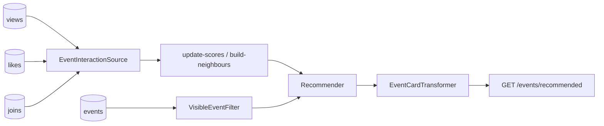

# Example: recommended events listing

Meetup / community **events** people can **view**, **like**, and **join** (RSVP). The feed recommends upcoming (or recent) events for a user — not `ORDER BY RAND()`.

| Table | Event | Default weight |
|---|---|---|
| `event_views` | `view` | 1.0 |
| `event_likes` | `like` | 4.0 |
| `event_joins` | `join` | 10.0 |

Covered by [`EventsExampleTest`](../../tests/Feature/EventsExampleTest.php).

Want **district / living area / favorite event type** on top of this? See the full standalone copy in [`../events-advanced`](../events-advanced/).



## Layout

`Models/` · `Interactions/` · `Sources/` · `Filters/` · `Cards/` · `Groups/` · `Http/` — see [examples README](../README.md).

## Try it

```bash
vendor/bin/pest tests/Feature/EventsExampleTest.php
```

## Use in your app

1. Copy `src/` folders → `app/Recommendation/Events` (fix namespaces).
2. Merge feed `events` into `config/recommender.php`.
3. Route → `Http/RecommendedEventsController` (or Livewire + `toPaginator()`).
4. Scaffold shortcut: `php artisan recommender:make-feed events --preset=events -n`

Neighbours use **like + join** only (not every view). Filter hides unpublished / past / own-hosted events.
