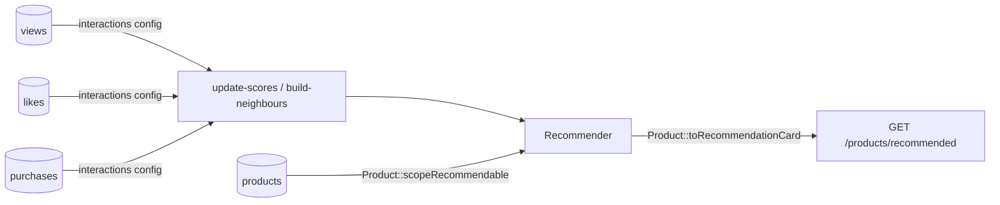

# Example: product catalog (three event types)

Shows that interactions are **not only likes/views**:

| Table | Event | Default weight |
|---|---|---|
| `product_views` | `view` | 1.0 |
| `product_likes` | `like` | 4.0 |
| `product_purchases` | `purchase` | 10.0 |

Covered by [`ProductsExampleTest`](../../tests/Feature/ProductsExampleTest.php).



Similar items are built from `positive_events` (like + purchase), not every view. `'diversity' => ['seller_id' => 1]` keeps one product per seller per page.

### New products (attribute match)

A product nobody has viewed, liked or bought yet has no neighbours. The feed's `match` config finds it by its own attributes:

```php
'match' => [
    'category_id' => 2.0,                             // same category
    'price' => ['weight' => 1.0, 'type' => 'range'],  // similar price
],
'sources' => [
    CoInteractionSource::class => 0.50,
    AttributeMatchSource::class => 0.15,   // "more like what you just liked", new products included
    TrendingSource::class => 0.35,
],
```

- `AttributeMatchSource` shows a new jacket to someone who just liked a jacket at a similar price.
- `$product->similar(4)` falls back to the same category and price for products without neighbours.
- Each call scores at most `match_pool` (200) candidates in a fixed number of queries; nothing is stored. Details: [reference → attribute match](../../docs/reference.md#new-items-attribute-match).

## Try it

```bash
vendor/bin/pest tests/Feature/ProductsExampleTest.php
```

## Use in your app

1. Merge the feed from `config/recommender.php` into yours (`model` → your model class).
2. Copy the model's `scopeRecommendable()` and `toRecommendationCard()` into your model, and add `use Recommendable;`.
3. Route: `Route::get('/products/recommended', fn (Request $r) => Product::recommendedFor($r->user()));`
4. Check it: `php artisan recommender:doctor products`. The scoring jobs are scheduled by the package — keep Laravel's scheduler running.

Add any other table as a new event: `'product_shares' => 'share'`, then give `share` a weight under `events`.
