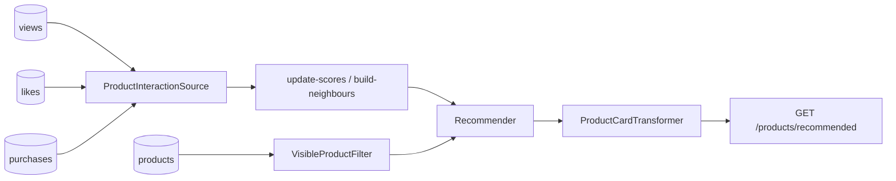

# Example: product catalog (three event types)

Shows that interactions are **not only likes/views**. Here we stream:

| Table | Event | Default weight |
|---|---|---|
| `product_views` | `view` | 1.0 |
| `product_likes` | `like` | 4.0 |
| `product_purchases` | `purchase` | 10.0 |

Covered by [`ProductsExampleTest`](../../tests/Feature/ProductsExampleTest.php).



## Try it

```bash
vendor/bin/pest tests/Feature/ProductsExampleTest.php
```

## Use in your app

1. Copy `src/*` → `app/Recommendation/Products` (fix namespaces).
2. Merge `config/recommender.php` feed `products`.
3. Add the route.
4. Yield any extra event names you need — register them under `events` / `positive_events`.
