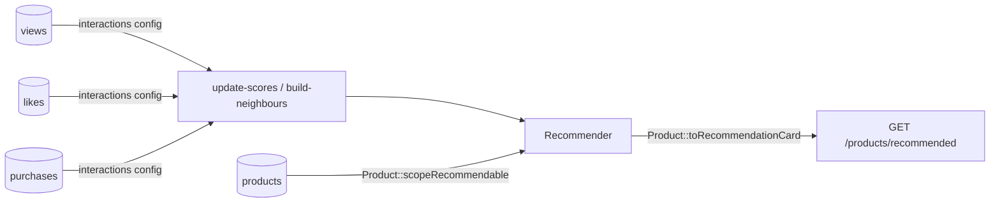

# Example: product catalog (three event types)

Shows that interactions are **not only likes/views**:

| Table | Event | Default weight |
|---|---|---|
| `product_views` | `view` | 1.0 |
| `product_likes` | `like` | 4.0 |
| `product_purchases` | `purchase` | 10.0 |

Covered by [`ProductsExampleTest`](../../tests/Feature/ProductsExampleTest.php).



Similar items are built from `positive_events` (like + purchase), not every view. `'diversity' => ['seller_id' => 1]` keeps one product per seller per page.

## Try it

```bash
vendor/bin/pest tests/Feature/ProductsExampleTest.php
```

## Use in your app

1. Merge the feed from `config/recommender.php` into yours (`model` → your model class).
2. Copy the model's `scopeRecommendable()` and `toRecommendationCard()` into your model, and add `use Recommendable;`.
3. Route: `Route::get('/products/recommended', fn (Request $r) => recommendations('products', $r->user()));`
4. Check it: `php artisan recommender:doctor products`, then schedule `update-scores` / `build-neighbours` — see [the tutorial](../../docs/tutorial.md#5-keep-it-updated).

Add any other table as a new event: `'product_shares' => 'share'`, then give `share` a weight under `events`.
