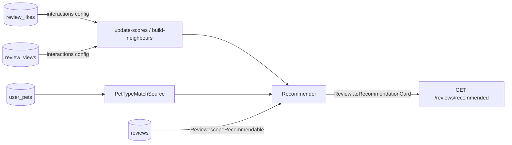

# Example: shop reviews

UGC reviews on shops, with a **custom rule source** (`PetTypeMatchSource`: same pet type as the viewer). A personalised review feed instead of `ORDER BY RAND()`.

Covered by [`ReviewsExampleTest`](../../tests/Feature/ReviewsExampleTest.php).



| Path | Role |
|---|---|
| `config/recommender.php` | The feed; `'diversity' => ['shop_id' => 2, 'user_id' => 1]` (per shop / per writer) |
| `src/Models/Review.php` | Visibility (published, has cover, shop open, not mine) + card |
| `src/Sources/PetTypeMatchSource` | Same `pet_type_id` as the viewer |
| `src/Http/` | One-line controller |

## Try it

```bash
vendor/bin/pest tests/Feature/ReviewsExampleTest.php
```

## Use in your app

1. Merge the feed from `config/recommender.php` into yours (`model` → your model class).
2. Copy the model's `scopeRecommendable()` and `toRecommendationCard()` into your model, and add `use Recommendable;`.
2b. Replace `pet_type_id` with your real affinity rule (category, district, …).
3. Route: `Route::get('/reviews/recommended', fn (Request $r) => Review::recommendedFor($r->user()));`
4. Check it: `php artisan recommender:doctor reviews`. The scoring jobs are scheduled by the package — keep Laravel's scheduler running.
