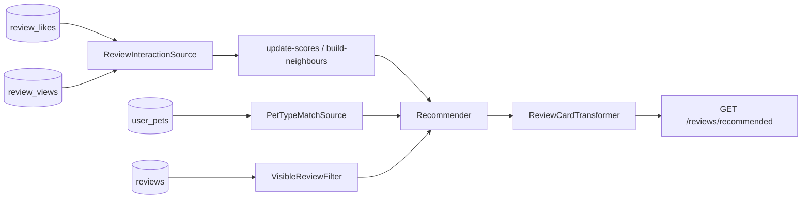

# Example: shop reviews / inspiration

UGC reviews on shops, with a **custom rule source** (`PetTypeMatchSource`: same pet type as the viewer). Mimics an inspiration feed without AWS Personalize / `ORDER BY RAND()`.

Covered by [`ReviewsExampleTest`](../../tests/Feature/ReviewsExampleTest.php).



| Path | Role |
|---|---|
| `src/Interactions/` | likes + views |
| `src/Sources/PetTypeMatchSource` | same `pet_type_id` as viewer |
| `src/Filters/` | published, has cover, not mine |
| `src/Groups/` | diversity by shop |
| `src/Models/` · `Cards/` · `Http/` | model, cards, controller |

## Try it

```bash
vendor/bin/pest tests/Feature/ReviewsExampleTest.php
```

## Use in your app

1. Copy `src/*` → `app/Recommendation/Reviews` (fix namespaces).
2. Merge feed `reviews` into `config/recommender.php`.
3. Replace `pet_type_id` with your real affinity rule (category, district, …).
